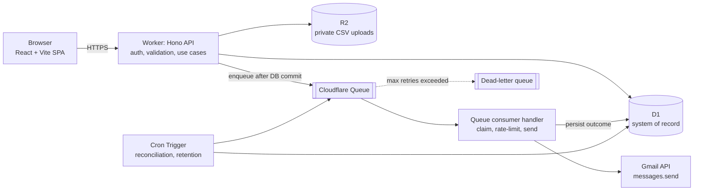

# Sendlab

> **Status:** Early build. The UI is connected to a real local API for **Contacts, Campaigns and CSV imports**. Launch, test send, sending, Settings, suppression and authentication are not built yet. This README is the implementation plan derived from `email_campaign_platform_project_brief_v2.pdf` (prepared 6 Nov 2026). Section 12 records the decisions made so far (multi-user, Cloudflare Access, service-account Gmail auth, global contacts, one-time import with a 500/day drip send) and the items that are still open.

Sendlab is a web application that imports client contacts from CSV files, lets users build email campaigns, and sends **one individually addressed email per recipient** through a Google Workspace Gmail account. Sending is asynchronous, using Cloudflare Queues and Workers.

### Backend (started: Contacts and Campaigns only)

Cloudflare Worker + Hono + D1 + Drizzle, under `src/server`. Built so far: the database schema, repositories and API routes for **Contacts, Campaigns and CSV imports**, the status state machines, and a health endpoint. Not built yet: campaign **launch**, test-send, retry-failed, the queue, Gmail, suppression, and real authentication. The UI is connected to this API for Contacts, Campaigns, Campaign details, the Campaign editor and Overview (see **Running it locally**).

> **Security status:** the API has no real authentication yet. Every route except `/api/health` fails closed with `503 AUTH_NOT_CONFIGURED` unless `ENVIRONMENT` is `local` (set in `wrangler.jsonc`), so deploying this build cannot expose contacts or campaigns. Locally, requests run as `dev@local`. Roles (Administrator, Campaign Manager, Viewer) are not enforced yet. Cloudflare Access + role checks come next (D-02).

#### API

All list endpoints take `page` (default 1) and `pageSize` (default 25, max 100) and return `{ items, page, pageSize, total }`. Errors always use `{ error: { code, message, details?, correlationId } }`, and the correlation ID is also the `X-Correlation-Id` header. JSON bodies are limited to 1 MB. Unknown properties are rejected, so a typo never silently drops data.

| Method + path | Purpose |
|---|---|
| `GET /api/contacts` | List. Filters: `q` (name, title, company, email), `industry`, `consent` |
| `POST /api/contacts` | Create. Email is trimmed and normalized. A duplicate returns `409 EMAIL_EXISTS` with the existing `contactId` |
| `GET` / `PATCH` / `DELETE /api/contacts/:id` | Read, partial update (a changed email is re-normalized), delete. Campaign history keeps its snapshot |
| `GET /api/contacts/industries` | Distinct, non-empty industries (for the filter dropdown) |
| `POST /api/imports` | **Upload a CSV** (`multipart/form-data`: `file` and `mapping`, JSON `{ "email": 4, "firstName": 0, ... }`). The server parses and validates it itself, creates the contacts that do not exist, records every row, and answers `201` with the authoritative counts |
| `GET /api/imports` · `/api/imports/:id` | Import history and one import |
| `GET /api/imports/:id/rows` | Row results, paginated. Filters: `outcome`, `show=rejected` |
| `GET /api/imports/:id/rejected-rows.csv` | Download of every rejected row (formula-injection safe) |
| `GET /api/campaigns` | List summaries (no bodies) with recipient counts. Filters: `status`, `q`, `archived=exclude\|include\|only` |
| `POST /api/campaigns` | Create a Draft. Status and owner cannot be set by the client. `recipientImportId` must be a Completed import, or null for all contacts |
| `GET /api/campaigns/:id` | Full campaign with `totals` (recipient counts by status) |
| `PATCH /api/campaigns/:id` | Edit a **Draft** only (`409 CAMPAIGN_LOCKED` otherwise) |
| `DELETE /api/campaigns/:id` | Delete a Draft only. Archive anything else |
| `POST /api/campaigns/:id/duplicate` | New Draft with the same content and schedule, no recipients |
| `POST /api/campaigns/:id/archive` · `/unarchive` | Hide or restore. Refused while Queuing, Queued or Sending |
| `POST /api/campaigns/:id/pause` · `/resume` · `/cancel` | State changes through the state machine (`409 INVALID_TRANSITION` if illegal). Cancel also cancels unsent recipients atomically. Already-accepted mail cannot be recalled |
| `GET /api/campaigns/:id/recipients` | Recipients in send order. Filters: `status`, `q` |

#### CSV import behaviour

- **The server is the authority.** The browser previews with the same code (`src/shared/csv.ts`), but the file is uploaded and parsed again on the server when you confirm, and the server's counts are the ones saved. The UI says so if they ever differ.
- **Limits:** `.csv` only, 10 MB, 20,000 rows. A binary file renamed to `.csv`, an unclosed quote, or a header with no data is refused with `422 INVALID_CSV` and records nothing. Over the size limit returns `413`.
- **Contacts are global.** An address that already exists (matched ignoring letter case and surrounding spaces) is skipped and **never overwritten**. Re-uploading the same file creates nothing, so a failed or repeated import is safe.
- **Nothing is silently dropped.** Rejected rows keep their row number, the cell text (cut to 500 characters) and the reason, and can be downloaded from the import history at any time.
- **Not atomic across a whole file** (D1 writes are atomic per batch, a file is many batches). If it fails midway the import is marked `Failed`, the contacts saved so far are kept, and uploading the file again finishes the job. A crash leaves the import visibly `Processing`.
- **Fast enough for your list.** Bulk writes send each chunk of rows as one bound JSON array that SQLite expands, which keeps clear of D1's 100-parameter limit. An 8,000-row file imports in about 1.5 seconds locally (the first approach, small multi-row inserts, took 15 seconds). Each import logs its phase timings, with no addresses or file content.
- **The original file is not kept.** It is parsed in the same request, so nothing needs storing. R2 would only be needed to edit the column mapping after upload.

#### State machines

`src/shared/status.ts` is the single source of truth for legal status changes (campaign and recipient), shared by the API and the UI, with exhaustive unit tests. Highlights: a recipient reaches `Accepted` only from `Processing` and `Processing` only from `Queued`. `Accepted`, `Skipped` and `Cancelled` are final. Campaigns launch `Draft -> Sending`, only `Draft` is editable, and `Completed` and `Cancelled` are final. Updates are guarded by the status that was read, so two concurrent actions cannot both succeed.

#### Tests

`npm test` runs 172 tests: state machines, validation schemas, IDs, the CSV parser, the API including CSV imports up to 8,000 rows (against in-memory D1), and the UI pages (rendered in a simulated browser with the network stubbed, checking they call the API correctly and handle errors, empty states and read-only roles). The integration tests run the real Hono app and repositories against an in-memory D1 database (Miniflare) built from the committed migrations, so they never touch your local dev data. `npm run typecheck` covers the front end, the server, the server-side tests and the UI tests (the last two use separate configs, because browser and Cloudflare Worker types define clashing globals).

| Table | Purpose |
|---|---|
| `contacts` | Global contacts, one row per `normalized_email`. Columns follow `template.csv` |
| `campaigns` | Content, status, and the daily-drip settings (`daily_limit`, send window, timezone, `next_run_at`) |
| `imports` | One row per CSV upload: filename, size, the confirmed column mapping, and the server's authoritative counts (valid, created, already existing, rejected by reason). Status is Processing, Completed or Failed |
| `import_rows` | The outcome of **every** CSV row: `Created`, `Existing` (both linked to a contact), or rejected (`Blank`, `Malformed`, `Duplicate`, `Bad row`). The rows linked to a contact are exactly the recipients of "this import" |
| `campaign_recipients` | One row per (campaign, contact) with an email and merge-field snapshot, a stable `sequence`, status and lease. Included now because it is the link between the two |

Design points: UUIDv7 text IDs, UTC millisecond integer timestamps, enums as `TEXT` with `CHECK` constraints (values live in `src/shared/types.ts`), and `contact_id` uses `ON DELETE SET NULL` so a contact can be erased while the campaign keeps its snapshot. `campaigns.recipient_import_id` (null = every contact, otherwise the people in that import) is saved with the draft and resolved into `campaign_recipients` at launch. Columns that point at tables not built yet (`created_by`, `sender_account_id`) are plain text for now. `contacts.source_import_id` and `campaigns.recipient_import_id` are soft references with no foreign key on purpose: adding one to an existing SQLite table forces a table rebuild, and rebuilding `contacts` or `campaigns` would cascade into `campaign_recipients`.

```bash
npm run db:generate          # after editing src/server/database/schema/*, creates a migration
npm run db:migrate:local     # apply to the local D1 database (.wrangler/state)
npm run dev:api              # Worker on http://localhost:8787, try /api/health
npm run cf-typegen           # regenerate worker-configuration.d.ts after editing wrangler.jsonc
npm run typecheck            # front end and server
```

`wrangler.jsonc` holds placeholder database IDs for staging and production. Replace them with the IDs printed by `wrangler d1 create`.

### Running it locally

Two terminals, then open http://localhost:5173:

```bash
npm install
npm run db:migrate:local   # once, and after each new migration
npm run dev:api            # terminal 1: the API (wrangler dev, http://127.0.0.1:8787)
npm run dev                # terminal 2: the UI (Vite). Vite proxies /api to the API
npm run seed:local         # optional: imports the 25 contacts in public/template.csv and creates one sample draft
```

The seed script imports `public/template.csv` through the real import endpoint, and is safe to run twice. It refuses to talk to anything but a local API.

**What is live and what is still a preview**

| Area | Status |
|---|---|
| Contacts: list, search, filters, add, edit, delete | **Live** (API + D1) |
| Campaigns: list, create, edit draft, duplicate, archive, delete draft | **Live** |
| Campaign details: totals, recipients, pause, resume, cancel | **Live**. Refreshes every 10 seconds while a campaign is Sending |
| Overview | **Live**, derived from the campaigns list (there is no dashboard endpoint yet) |
| Imports (CSV): upload, map, review, confirm, history, rejected-rows download | **Live**. The browser previews, the server imports and answers with the real counts |
| Campaign recipients (all contacts, a saved import, or upload a CSV there) | **Live and saved with the draft**. The recipient list itself is built at launch, which is not built yet |
| Launch, test send, retry failed | Not built. The launch dialog saves a draft and says so |
| Settings, suppression, users | Preview only (mock values) |
| Authentication and roles | Not built. The "Preview as" selector only changes what the UI shows. The API does not enforce roles |

The UI talks to the API through `src/client/services/` (a small typed client plus TanStack Query hooks). Request and response shapes come from `src/shared/`, so the UI and server cannot drift apart. The CSV parsing and validation (`src/shared/csv.ts`) runs in the browser for the preview and in the Worker as the authority.

If the API is not running, pages show "Could not reach the API. Start it with `npm run dev:api`".

---

## Table of Contents

1. [Goals, Scope and Non-Goals](#1-goals-scope-and-non-goals)
2. [Feature Catalog (MVP vs Post-MVP)](#2-feature-catalog-mvp-vs-post-mvp)
3. [Technology Stack](#3-technology-stack)
4. [System Architecture](#4-system-architecture)
5. [Database Design](#5-database-design)
6. [State Machines](#6-state-machines)
7. [Key Subsystems](#7-key-subsystems) (Import, Email/Gmail, Queue, Security)
8. [API Surface](#8-api-surface)
9. [Development Conventions](#9-development-conventions)
10. [Project Structure](#10-project-structure)
11. [Implementation Phases](#11-implementation-phases)
12. [Architectural Gaps and Open Decisions](#12-architectural-gaps-and-open-decisions)
13. [Setup Instructions](#13-setup-instructions)
14. [Acceptance Criteria](#14-acceptance-criteria)
15. [References](#15-references)

---

## 1. Goals, Scope and Non-Goals

**Primary goals**

- Import `.csv` contact lists that follow the `template.csv` columns (see [CSV data structure](#csv-data-structure)). Email is the only required column. The same upload is available when creating a campaign.
- Validate, normalize and deduplicate addresses, with every rejected row reviewable and downloadable.
- Create campaigns (name, subject, HTML body, optional text body, sender, recipients) with preview and test-send.
- Send each recipient a separate message. No shared To/CC/BCC.
- Send asynchronously, so no browser request stays open while mail is sent.
- Track Pending, Queued, Processing, Accepted, Failed, Skipped and Cancelled states, with retries and a full attempt audit trail.
- Provide a dashboard and campaign detail view with progress and sanitized errors.

**Assumptions (from the brief)**

- Internal business-outreach tool, not multi-tenant SaaS.
- One Workspace mailbox initially; provider/account abstractions leave room for more.
- D1 (SQLite) is the database. PostgreSQL is not to be substituted without the owner's explicit decision.
- Cloudflare Workers, D1, Queues and R2 are the infrastructure foundation. No VPS or always-on server.
- Credentials are supplied later. Only placeholders are scaffolded. Nothing is invented or committed.

**Non-goals for v1**

- Marketing automation, lead scoring, CRM, complex segmentation.
- Guaranteed inbox delivery. Gmail API acceptance is not delivery, so the UI says **"Accepted by Gmail"**, never "Delivered".
- High-volume bulk sending. Gmail Workspace limits apply. Move to a dedicated ESP if volume grows.
- Drag-and-drop email designer.

---

## 2. Feature Catalog (MVP vs Post-MVP)

| Feature | Tier | Notes |
|---|---|---|
| Dashboard (KPIs, recent campaigns, queue health) | MVP | |
| CSV import (column map, preview, validate, dedupe, invalid-row download) | MVP | Follows `template.csv`. Parsed in the browser in the mock UI |
| Upload a CSV while creating a campaign (alternative to picking an existing import) | MVP | Same validation as Imports. The upload becomes an import and its contacts are saved globally |
| Contact management (search, filter, edit, source import) | MVP | |
| Campaign CRUD (create, edit, duplicate, archive drafts) | MVP | Content locks at launch (see D-12) |
| Email preview + test-send | MVP | Test-send must never enqueue the full list |
| Individual sending (1 recipient per message) | MVP | |
| Queue processing (bounded concurrency, rate limits, retries, DLQ, idempotency) | MVP | |
| Campaign monitoring (progress, per-recipient status, attempts, errors, message ID) | MVP | |
| Failure recovery (explicit, auditable retry) | MVP | |
| Settings (mailbox status, OAuth connect/reconnect, sending limits, health) | MVP | |
| Security (auth, roles, private R2, secrets, audit events for launch and account changes) | MVP | |
| Suppression / unsubscribe | **MVP, recommended** | Brief marks it "strongly recommended" and lists it as an open decision (D-07) |
| Pause / cancel | MVP | Brief marks it "where feasible" |
| Resume | Post-MVP | |
| Reusable templates | Post-MVP | `email_templates` table optional |
| Merge fields beyond `firstName`/`companyName` | Post-MVP | Basic merge fields are MVP |
| **Daily drip sending** (cap of N per day, e.g. 500, until the list is exhausted) | **MVP** | Core requirement, see §7.5. Replaces generic scheduling for v1 |
| Scheduling (arbitrary future date/time) | Post-MVP | Needs Cron Triggers |
| Segmentation / tags | Post-MVP | |
| Attachments | Post-MVP | |
| CSV exports of results | Post-MVP | Invalid-row report is MVP |
| Multiple sender accounts | Post-MVP | Schema is designed for it now |
| Analytics, notifications | Post-MVP | |
| Full audit history UI | Post-MVP | MVP records the events |

**Screens:** Overview, Imports, Contacts, Campaigns, Campaign editor, Campaign details, Templates (post-MVP), Settings.

**Roles:** *Administrator* (everything, plus users, settings, sender connection), *Campaign Manager* (import, manage contacts and campaigns, test-send, launch, monitor), *Viewer* (read-only).

---

## 3. Technology Stack

| Layer | Choice | Responsibility |
|---|---|---|
| Language | TypeScript (strict) | One language across UI, API and queue consumer |
| Frontend | React + Vite | SPA, served via Workers static assets |
| Styling | Tailwind CSS | |
| API runtime | Cloudflare Workers | Serverless; no always-on process |
| API framework | Hono | Routing, middleware, validation |
| Database | Cloudflare D1 | Managed SQLite; system of record |
| ORM/migrations | Drizzle ORM + Drizzle Kit (`drizzle-orm/sqlite-core`) | Typed schema and migrations |
| Async jobs | Cloudflare Queues + consumer handler | Recipient-level email jobs, DLQ |
| Object storage | Cloudflare R2 (private) | Uploaded CSV files, generated reports |
| CSV parsing | Small in-repo RFC 4180 parser (`src/client/lib/csv.ts`, no dependency; shared with the Worker later) | Header row, quoted fields, validation. Replaces SheetJS (see **D-04**) |
| Email | Gmail API, authenticated by a Google **service account with domain-wide delegation** (D-05) | Send as the Workspace mailbox |
| Validation | Zod | API payloads, env bindings, parsed rows |
| Testing | Vitest (+ Workers test pool) | Unit, service and integration tests |
| Tooling | Wrangler | Local D1/R2/Queues simulation, deploy |
| CI/CD | GitHub + GitHub Actions | Lint, typecheck, test, deploy |

Pin **current stable** versions at scaffold time, and verify Workers runtime compatibility for each dependency. Node-only libraries may need `nodejs_compat` or may not work at all.

**Hosting model:** a single Worker with static assets. Its `fetch`, `queue` and `scheduled` handlers deploy together. Split only for a concrete operational reason. Cloudflare Pages is not used.

---

## 4. System Architecture



**Principles**

1. **D1 is the system of record.** Queues are transport only. Persist the recipient job rows *before* publishing messages.
2. **At-least-once processing.** Every consumer step is idempotent, guarded by a stable key and a conditional-`UPDATE` claim.
3. **Honest status.** "Accepted" means Gmail took the message. Delivery or bounce is a separate signal, post-MVP.
4. **Thin edges.** Routes handle HTTP, services implement use cases, repositories wrap Drizzle/D1, providers wrap Gmail, and queue handlers only orchestrate. Cloudflare bindings sit behind interfaces so unit tests can fake them.

**Main flows**

- *Import:* upload to R2, create an `imports` row, parse, return a preview (headers and sample rows). The user maps columns, rows are validated into `import_rows`, and the user confirms to upsert `contacts`.
- *Launch:* validate campaign, sender, eligible recipients and compliance settings. In a batched write, create `campaign_recipients` as `Pending` and set the campaign to `Queuing`. Then `sendBatch` to the queue in chunks, mark recipients `Queued`, and set the campaign to `Queued`. If the request dies mid-way, reconciliation re-enqueues the remaining `Pending` rows.
- *Send (consumer):* validate payload, load rows, atomically claim (`Queued → Processing` with a lease), re-check suppression, campaign state and rate limit, build the MIME message, call Gmail, then record the `email_attempts` row and the recipient outcome. Retry transient errors with backoff. Mark permanent errors `Failed`.
- *Monitor:* the browser polls paginated API endpoints backed by D1 aggregates.

---

## 5. Database Design

SQLite dialect via Drizzle `sqlite-core`. Never use PostgreSQL-specific SQL.

**Conventions:** IDs are sortable and collision-resistant (UUIDv7 or ULID, see D-10). Timestamps are UTC Unix milliseconds in `INTEGER` columns (see D-10). Store original and normalized email. Normalization is `trim` plus lowercase only, with no Gmail-dot removal. Enums are `TEXT` with a `CHECK` constraint. Foreign keys are enforced. Use `db.batch()` for multi-statement atomic writes.

**Tables (proposed; the brief's list is a starting point, additions marked ➕)**

| Table | Purpose | Key columns |
|---|---|---|
| `users` | App identities (if app-managed auth) | id, email, display_name, role, created_at |
| `imports` | CSV uploads | id, file_key, original_filename, status, column_mapping (JSON), row_count, valid/invalid/duplicate/blank counts, created_by, created_at |
| `import_rows` | Row-level validation results | id, import_id, row_number, raw_email, normalized_email, validation_status, error, raw_data (JSON), contact_id |
| `contacts` | Normalized, reusable contacts | id, email, normalized_email (**UNIQUE**, global scope, D-06), first_name, last_name, title, company_name, employees, industry, linkedin_url, website, city, state, country, annual_revenue (the `template.csv` fields), source_import_id, consent_status, consent_source, created_at, updated_at |
| ➕ `suppressions` | Opted-out, bounced, complained or manually blocked addresses | id, normalized_email (UNIQUE), reason, source, created_at |
| `campaigns` | Config and aggregate state | id, name, subject, html_body, text_body, status, sender_account_id, scheduled_at, archived_at, launched_at, created_by, timestamps; **drip fields** ➕: daily_limit, send_window_start/end, timezone, next_run_at, last_run_at |
| `campaign_recipients` | Recipient-level work | id, campaign_id, contact_id, email_snapshot, **personalization_snapshot (JSON)** ➕, status, attempt_count, lease_expires_at ➕, queued_at, sent_at, last_error; **UNIQUE(campaign_id, contact_id)** |
| `email_attempts` | Audit trail of every attempt | id, campaign_recipient_id, attempt_number, outcome, provider_message_id, error_code, error_message (sanitized), attempted_at |
| `sender_accounts` (replaces `oauth_accounts`) | Sender mailbox config. With a service account there are no per-user refresh tokens to store; the private key is a Worker secret | id, provider, mailbox_email (the impersonated user), scopes, status, last_verified_at, updated_at |
| ➕ `sending_limits` / `app_settings` | Per-account per-minute and daily caps, retention periods, test-address allowlist | |
| ➕ `audit_events` | Who did what (launch, retry, settings, connect) | id, actor_id, action, entity_type, entity_id, metadata (JSON, no secrets), created_at |
| `email_templates` (post-MVP) | Reusable templates | id, name, subject_template, html_body, text_body, created_at |

**Indexes:** `campaign_recipients(campaign_id, status)`, `contacts(normalized_email)` unique, `import_rows(import_id, validation_status)`, `email_attempts(campaign_recipient_id)`, `suppressions(normalized_email)` unique, `campaign_recipients(status, lease_expires_at)` for reconciliation.

**D1 constraints to design around:** D1 has no long-lived interactive transactions, so use `batch()` and conditional `UPDATE ... WHERE status = ?`. Bound-parameter and statement-size limits cap bulk inserts, so chunk them. Writes are serialized per database, so measure launch throughput at expected campaign size. D1 has no TTL, so retention needs a scheduled purge.

---

## 6. State Machines

**Campaign:** `Draft → Queuing → Queued → Sending → Completed | CompletedWithErrors | Failed`, with `Paused` (from `Queued`/`Sending`) and `Cancelled` (from any non-terminal state). The brief's §2 and §8 lists differ, so this README adopts the §8 superset (D-13).

**Campaign recipient:** `Pending → Queued → Processing → Accepted | Failed`, with `Skipped` (suppressed, invalid, quota hold) and `Cancelled`. `Processing → Queued` is allowed on lease expiry. `Failed → Queued` is allowed only through an explicit, audited retry of transient or manually approved failures.

Transitions live in one pure, unit-tested module. No code outside it may write a status directly.

---

## 7. Key Subsystems

### 7.1 CSV import
- Accept `.csv` only (UTF-8, optional BOM; CRLF, LF or CR line endings). Check the extension, size and content. A file that begins with the ZIP signature (an Excel workbook renamed to .csv) or contains NUL bytes is rejected with a hint to "Save As CSV UTF-8". Don't trust the MIME type.
- Enforce configurable limits: file size (10 MB) and row count (20,000). A real parser handles quoted fields, escaped quotes and embedded newlines.
- Column mapping is automatic for the `template.csv` headers (case and punctuation-insensitive aliases) and always editable, so a header named differently from "Email" still works. Email is the only required mapping.
- Rows with **more** cells than the header are rejected as "Bad row" (usually an unquoted comma). Rows with fewer cells are padded.
- Report blank, malformed, duplicate and bad rows by source row number (header = row 1). Duplicates are matched case-insensitively and the first copy wins. Syntax validation does not prove a mailbox exists.
- A non-numeric `# Employees` or `Annual Revenue` does not reject the row. The value is left blank and the count is reported as a warning.
- Keep invalid rows reviewable (`GET /imports/:id/rows`) and downloadable. The downloaded report neutralizes spreadsheet formula injection (cells starting with `=`, `+`, `-` or `@` are prefixed with `'`). Store the original file in private R2 under a retention rule.
- Contacts are global. On confirm, new addresses are created, and addresses that already exist keep their current details (nothing is overwritten).

#### CSV data structure

The columns of `template.csv`, in order, and where each is used:

| CSV column | Field | Required | Notes |
|---|---|---|---|
| First Name | `firstName` | No | Merge field `{{firstName}}`, fallback "there" |
| Last Name | `lastName` | No | `{{lastName}}` |
| Title | `title` | No | `{{title}}` |
| Company Name | `companyName` | No | `{{companyName}}`, fallback "your company". May contain commas when quoted |
| **Email** | `email` | **Yes** | Stored as entered and normalized (trim, lower-case). Unique per contact |
| # Employees | `employees` | No | Integer. Blank or non-numeric becomes null |
| Industry | `industry` | No | `{{industry}}`, fallback "your industry". Contact filter |
| Person Linkedin Url | `linkedinUrl` | No | Display only |
| Website | `website` | No | `{{website}}` |
| City | `city` | No | `{{city}}` |
| State | `state` | No | `{{state}}` |
| Country | `country` | No | `{{country}}` |
| Annual Revenue | `annualRevenue` | No | Whole dollars. Blank or non-numeric becomes null |

The supported merge fields are exactly: `{{firstName}}`, `{{lastName}}`, `{{title}}`, `{{companyName}}`, `{{industry}}`, `{{city}}`, `{{state}}`, `{{country}}`, `{{website}}`, plus `{{unsubscribeUrl}}`. Values are HTML-escaped. Unknown tags block launch. The CSV carries no consent column, so imported contacts start with consent "Unknown" (see D-26).

### 7.2 Email and Gmail
- **Auth: service account with domain-wide delegation (D-05, decided).** The Worker signs a JWT (RS256, WebCrypto, no Node-only Google SDK) with the service-account private key, sets `sub` to the sender mailbox, and exchanges it for a short-lived access token (about 1 hour). Cache the token in memory per isolate and re-mint when it expires. No OAuth consent screen, callback route, refresh-token storage or 7-day expiry.
- The private key lives only in a Worker secret. Never log it or the minted tokens.
- A Workspace **super-admin** must authorize the service account's client ID for the `gmail.send` scope only (Admin console → Security → API controls → Domain-wide delegation).
- **Risk:** delegation lets the service account impersonate any user in the domain for the granted scopes. Mitigate by granting only `gmail.send`, hard-allowlisting the single sender mailbox in app config (the code must refuse any other `sub`), and keeping the key out of every repo and log.
- Use a dedicated sending mailbox (D-09).
- Build the MIME message (To, From, Subject, MIME-Version, Content-Type, multipart/alternative), then base64url-encode it for `messages.send`.
- Escape all merge-field values inserted into HTML. Allow only a fixed placeholder set. Never execute user-supplied template code.
- From must be the authenticated mailbox or a configured send-as alias.
- Classify errors: **transient** (network, 5xx, 429/rate limit) retries with backoff. **Permanent** (invalid recipient, auth/permission revoked) fails without retry. **Auth-broken** pauses the whole campaign and alerts an admin.
- Quotas are configurable and conservative, never hard-coded. Check Google's current Workspace limits before launch. When a limit is hit, hold the campaign rather than fail recipients.

### 7.3 Queue processing and reliability
- Message payload: `{ campaignRecipientId, campaignId, idempotencyKey }`.
- Configure `max_batch_size`, `max_concurrency`, `max_retries`, retry delay and a **DLQ**. Messages that exhaust retries mark the recipient `Failed` and land in the DLQ for inspection.
- **Claim:** `UPDATE campaign_recipients SET status='Processing', lease_expires_at=? WHERE id=? AND status='Queued'`. Zero rows changed means skip and ack.
- **Rate limiting:** Queues has no native per-account limit. D-03 chooses a D1 counter or a Durable Object.
- **Reconciliation** (Cron Trigger): re-enqueue `Pending` rows older than a threshold, reset expired `Processing` leases, and complete campaigns whose recipients are all terminal. The brief lists Cron as optional, but this duty makes it effectively required (D-14).
- **Known uncertainty:** if Gmail accepts a message and the Worker dies before recording success, a retry could double-send. Gmail has no idempotency key. D-08 documents the mitigation options. The README and UI must state that exactly-once delivery is not promised.

### 7.4 Security, privacy, compliance
- Authenticate everything except the OAuth callback, health check and unsubscribe endpoint. Enforce RBAC server-side on every route.
- Use CSRF protection if cookie sessions are used. Apply input validation and upload limits.
- R2 is private. Access only through the Worker or short-lived signed URLs.
- Logs carry metadata only (campaign ID, recipient-job ID, attempt number, correlation ID). Never log bodies, tokens or unnecessary personal data.
- Track consent and source per contact. Honor suppression **at selection time and again immediately before send**.
- Define retention and deletion for uploaded CSV files, contacts, campaign content and logs. Check anti-spam and privacy laws for sender and recipient jurisdictions (CAN-SPAM, GDPR, CASL and so on). This is a legal review item, not only an engineering one.

### 7.5 Daily drip sending (one import, about 8K+ contacts, max 500 per day)

**Recommendation:** import once, store every row in D1, create all recipient rows at launch, but **enqueue only one day's batch at a time**. A daily Cron Trigger drives the schedule. Don't enqueue 8K messages up front. Queue delay limits, a long-lived backlog and awkward pause/cancel semantics make that worse, and this design makes the daily cap trivially enforceable.

**Import size.** 8K rows is small: a CSV of that size is a few MB at most. Parse it with the in-repo CSV parser (D-04), either in the browser (as the mock UI does) or in the Worker after streaming the upload to R2, under a cap of 20k rows and 10 MB. If testing shows memory problems on the Worker, split the work into chunked queue jobs. Persist rows to `import_rows` and `contacts` in chunks (D1 limits bound parameters per statement). After the import is confirmed, the CSV file can be deleted from R2 according to retention (D-21).

**Launch (once).** Validate, then create all `campaign_recipients` as `Pending` in chunked batched writes, snapshotting email and merge fields (D-12). Campaign content locks. Set `status = Sending`, `daily_limit = 500`, `next_run_at` = the next window start. The launch request enqueues nothing, so it is fast and cannot partially fail.

**Daily tick (Cron Trigger, idempotent).**
1. Skip if the campaign is `Paused`, `Cancelled` or terminal, or if the sender is disconnected.
2. Compute `remaining = daily_limit − (accepted + in-flight today)`, where "today" is the campaign's timezone day, counted from `email_attempts` in D1. The tick is safe to run twice.
3. Select up to `remaining` recipients with `status = Pending`, in a stable order (import row order), excluding suppressed contacts. Mark them `Queued` and `sendBatch` them with **staggered `delaySeconds`** (for example spread across the send window, one every few seconds). That keeps Gmail's per-minute behavior gentle and keeps sends inside business hours.
4. Update `last_run_at` and `next_run_at`.

**Consumer.** Unchanged from §7.3, plus a hard per-day check against `daily_limit` at claim time. If the cap is hit, return the recipient to `Pending` for tomorrow.

**Completion and "the schedule stops".** When no recipient is `Pending`, `Queued` or `Processing`, set `Completed` (or `CompletedWithErrors`), clear `next_run_at`, and make all later ticks a no-op. The Cron Trigger itself keeps running (it is global to the Worker and costs almost nothing). The campaign stops sending. With about 8,000 contacts at 500 per day, expect roughly **16 sending days** before retries.

**Edge cases to specify**
- *Failed recipients:* transient failures retry inside the day (queue backoff). Recipients that exhaust retries become `Failed` and are **not** auto-requeued. A manual, audited `retry-failed` puts them back into the pool, and they count against the daily cap when sent.
- *Quota:* test-sends and retries count toward the daily cap (D-23). Check Google's current Workspace limits to confirm 500/day sits well under the mailbox's cap, and don't hard-code a limit.
- *Unsubscribes mid-campaign:* suppression is re-checked at enqueue time and at send time, so someone who opts out on day 3 is skipped on day 9 and marked `Skipped`.
- *Pausing:* pausing stops the daily tick. Already-queued messages for that day are acked and returned to `Pending` by the consumer (D-24). Resume restores the schedule.
- *Missed days:* if a tick is missed (outage), the next tick sends the normal cap, not a catch-up burst.
- *Editing:* content, subject and daily limit are locked after launch. Changing the daily limit is allowed only while paused, and is audited.
- *Contacts added later:* a new import does not join a running campaign. Start a new campaign.

---

## 8. API Surface

Brief's proposal (all lists paginated, consistent error envelope, Zod-validated in and out):

| Method + path | Purpose |
|---|---|
| `POST /api/imports` | Upload CSV, create import |
| `GET /api/imports/:id` | Status and summary |
| `GET /api/imports/:id/rows` | Invalid/duplicate rows (paginated) |
| `POST /api/imports/:id/contacts` | Confirm and persist valid contacts |
| `GET /api/contacts` | List/search |
| `POST /api/campaigns` · `GET /api/campaigns` · `GET /api/campaigns/:id` · `PATCH /api/campaigns/:id` | Campaign CRUD |
| `POST /api/campaigns/:id/test-send` | Test to an authorized address |
| `POST /api/campaigns/:id/launch` | Validate, create jobs, enqueue |
| `POST /api/campaigns/:id/pause` · `/cancel` · `/retry-failed` | Controls |
| `GET /api/campaigns/:id/recipients` | Paginated statuses and errors |
| `GET /api/account/email` | Sender mailbox status |
| `GET /api/health` | Health, no secrets |

**Missing from the brief and needed for the stated features (see D-15):** `POST /api/imports/:id/mapping` (column mapping), `GET /api/oauth/google/start` and `/callback`, `PATCH /api/contacts/:id`, `POST /api/campaigns/:id/preview`, `/duplicate`, `/archive`, `/resume`, `POST /api/campaigns/:id/recipients/upload` (CSV upload from the campaign editor, creating an import), suppression CRUD, public signed `GET|POST /unsubscribe/:token`, invalid-row download, user/role admin, settings and limits, audit-event listing, DLQ inspection.

---

## 9. Development Conventions

- **TypeScript:** `strict`, `noUncheckedIndexedAccess`, `exactOptionalPropertyTypes`. No `any` without a justified comment.
- **Layering:** routes → services → repositories → Drizzle/D1. Providers (Gmail) and queue handlers call services. Routes never touch the DB directly.
- **Bindings:** a single typed `Env` interface. Env vars and secrets are validated by Zod at startup. Cloudflare bindings sit behind interfaces for testability.
- **Shared contracts:** Zod schemas in `src/shared` are the single source of truth for API request/response types, used by server and client.
- **Errors:** consistent envelope `{ error: { code, message, details?, correlationId } }`. Store only sanitized provider errors.
- **Logging:** structured JSON with correlation ID, campaign ID, recipient-job ID and attempt number. No PII beyond what's needed, no secrets, no bodies.
- **Migrations:** generated by Drizzle Kit, committed, and never edited after merge. Forward-only. Apply to local, then staging, then production.
- **IDs and time:** see D-10. Use one helper for each, and never call `Date.now()` or random IDs inside pure domain logic (inject them for tests).
- **State changes:** only through the state-machine module (§6).
- **Testing:** Vitest. Required coverage is validation, campaign and recipient state transitions, import parsing, queue message handling (including duplicate delivery) and Gmail error classification. Integration tests run against local D1/R2/Queues via the Workers test pool.
- **Lint and format:** ESLint (or Biome) + Prettier, enforced in CI (D-17). Conventional Commits. Short-lived feature branches, PR review, CI required to merge.
- **Secrets:** never in source, frontend bundles, logs, examples or screenshots. `.dev.vars` is git-ignored and `.dev.vars.example` is committed with placeholders.
- **Accessibility:** keyboard-accessible forms, tables, status labels and navigation. Don't convey status by color alone.
- **UI vocabulary:** Pending, Queued, Processing, **Accepted by Gmail**, Failed. Never "Delivered".

---

## 10. Project Structure

The brief's tree was garbled in extraction. This is the reconstructed intent.

```
sendlab/
├── src/
│   ├── client/                 # React app
│   │   ├── components/
│   │   ├── pages/
│   │   ├── hooks/
│   │   ├── services/           # typed API client
│   │   └── main.tsx
│   ├── server/
│   │   ├── app.ts              # Hono app + route registration
│   │   ├── index.ts            # Worker entry: fetch, queue, scheduled
│   │   ├── routes/
│   │   ├── modules/
│   │   │   ├── campaigns/
│   │   │   ├── contacts/
│   │   │   ├── imports/
│   │   │   ├── email/          # Gmail provider, MIME builder, templating
│   │   │   ├── accounts/       # OAuth, token vault
│   │   │   └── suppression/
│   │   ├── queue/
│   │   │   ├── producer.ts
│   │   │   ├── consumer.ts
│   │   │   └── reconcile.ts
│   │   ├── database/
│   │   │   ├── schema/
│   │   │   └── repositories/
│   │   ├── middleware/         # auth, RBAC, error envelope, correlation ID
│   │   └── services/
│   └── shared/                 # Zod schemas, shared types, constants
├── migrations/                 # Drizzle-generated SQL
├── tests/
├── public/
├── drizzle.config.ts
├── wrangler.jsonc
├── vite.config.ts
├── package.json
├── tsconfig.json
├── .dev.vars.example
└── README.md
```

---

## 11. Implementation Phases

Each phase is small, reviewable and ends with passing tests. Exit criteria are proposed.

| Phase | Deliverables | Exit criteria |
|---|---|---|
| **0. Foundation** | Repo, strict TS, Vite/React, Hono Worker, `wrangler.jsonc` (local/staging/prod), typed `Env`, lint/test/CI scripts | `npm run dev` serves UI + `/api/health`; CI green |
| **1. Data layer** | Drizzle schema, migrations, repositories, seed/test utilities, state-machine module | Migrations apply locally; repository and state-machine tests pass |
| **2. Contacts import** | R2 upload, CSV parsing, column mapping, validation preview, dedupe, persistence, invalid-row download | Acceptance items 1–2 pass on fixtures including hostile files |
| **3. Campaigns** | CRUD, HTML/text content, recipient selection, safe templating, preview | Draft + preview works; HTML-escaping tests pass |
| **4. Gmail integration** | Google Cloud project, service account and domain-wide delegation setup, JWT/token minting, Gmail provider, error classifier, test-send | Test email sent from the test mailbox; sender allowlist enforced; classifier tests pass |
| **5. Queue processing and drip** | Producer/consumer, daily-tick cron, per-day cap, staggered delays, retries, DLQ, idempotent claim, reconciliation | Duplicate-delivery, crash-recovery and tick-twice tests pass; staging run on real Queues over at least two simulated days |
| **6. Dashboard** | Overview, campaign list/detail, recipient table, retry/pause/cancel controls | Counts match persisted state |
| **7. Hardening and deploy** | Suppression/unsubscribe (public route, signed tokens), retention jobs, audit events, security review, staging then production rollout, monitoring | Security checks pass; staging soak test; production runbook |

**Authentication (Cloudflare Access + RBAC) is built in Phases 0–1**, not Phase 7. Retrofitting authorization into every route and the `created_by` columns later is far more expensive.

---

## 12. Architectural Gaps and Open Decisions

Items are ordered by impact. **Rec.** is the recommended default, used if no decision is made. Blocking items must be answered before the named phase starts.

### Decisions made

| ID | Decision | Consequence |
|---|---|---|
| D-01 | **Multi-user** with Administrator, Campaign Manager and Viewer roles | `users` table, RBAC middleware and audit events are in scope from Phase 1 |
| D-02 | **Cloudflare Access** in front of the Worker, with the Access JWT validated in-app. Roles are stored in D1, keyed by verified email | No password, session or CSRF code to write. Needs a Cloudflare Zero Trust org and an Access policy per environment. The first admin is bootstrapped from a configured email |
| D-04 | **One-time import, about 8K+ rows, stored in D1, worked from the database. Input is now CSV (`template.csv`), not Excel** | See §7.1 and §7.5. No SheetJS or other parsing dependency. Row cap 20k and 10 MB. The CSV file is deletable after confirmation. Supersedes the Excel parser concerns below |
| D-05 | **Service account with domain-wide delegation** | See §7.2. No OAuth callback or refresh tokens. Needs a Workspace super-admin to grant the scope. `oauth_accounts` becomes `sender_accounts` |
| D-06 | **Global contacts**, unique on `normalized_email` | Re-imports update blank fields only and never overwrite edits |
| D-07 | **Suppression and unsubscribe in MVP**, using suggested defaults | Signed-token public unsubscribe route, `List-Unsubscribe` and one-click header, a suppression list checked at enqueue and send. Launch is blocked until a sender postal address and an unsubscribe footer are configured |
| D-18 | **Scale: about 8K contacts, 500 per day, daily until exhausted** | Drip design in §7.5. This is far below Gmail Workspace limits and avoids needing rate-limit infrastructure beyond a daily cap and staggered delays |
| D-03 | *Resolved by design:* per-day cap checked from D1, plus `delaySeconds` staggering and low `max_concurrency`. A Durable Object is unnecessary at this scale | Revisit only if volume grows |
| D-26 | *Default accepted:* the compliance owner and jurisdictions are still **unnamed**. The defaults above are engineering controls, not legal advice | Please confirm the jurisdictions and owner before the first real send (not blocking for scaffolding) |

### Previously blocking (superseded by the table above; kept for rationale)

| ID | Gap / decision | Why it matters | Rec. |
|---|---|---|---|
| **D-01** | **Users and roles:** single internal user, or multiple users with the three roles in §17.4? The brief lists roles but also lists this as unconfirmed. | Drives the `users` table, `created_by` columns, RBAC middleware and audit events | Multi-user with roles. The schema cost is small now and expensive later. |
| **D-02** | **Authentication provider:** Cloudflare Access (SSO gate in front of the Worker, validate the Access JWT in the app) vs an app-managed library. | Access is the least code and safest for an internal tool, but needs a Cloudflare Zero Trust org, and users and roles still have to be mapped in D1. App-managed auth needs a library verified on Workers + D1 sessions, plus CSRF handling. | Cloudflare Access + JWT validation, with roles stored in D1 and keyed by verified email. Present the options before implementing. |
| **D-03** | **Rate limiting mechanism.** Queues has no per-account throttle, and `max_concurrency` alone isn't a rate limit. The brief says "configurable limits" but not how. | Needed to respect Gmail quotas and to hold campaigns at the daily cap | Use D1 counters (per-minute/day windows) with delayed re-queue (`delaySeconds`) for MVP. Use a Durable Object if precise limiting is needed. |
| **D-04** | *(Superseded: CSV input, see above.)* **Excel parsing library and location.** The `xlsx` package on the npm registry is stale and has known vulnerabilities. SheetJS's current releases are distributed from its own CDN. Workers also have tight memory limits, and parsing a large workbook in a Worker may fail. | Security (untrusted input), Workers compatibility, and the maximum import size | Decide the source (SheetJS CDN tarball vs an alternative such as a lighter, Workers-compatible reader), and whether to parse in the browser, the Worker, or a queue job. Set a conservative row cap (for example 20k) until measured. |
| **D-05** | **Gmail auth model and OAuth app type.** (a) User OAuth with refresh token, as the brief assumes. Consent screens left in *Testing* issue refresh tokens that expire in about 7 days. *Internal* user type (project inside the Workspace org) avoids that and avoids public verification. (b) Service account with domain-wide delegation: no refresh token to store, but it needs a Workspace super-admin to grant it. | Token lifecycle, encryption design, and whether production verification is needed | If the app and mailbox are in the same Workspace org, use an **Internal** OAuth consent screen. Evaluate domain-wide delegation. |
| **D-06** | **Contact scope:** global contacts (one row per normalized email) vs contacts scoped per import or list. | Changes `contacts` uniqueness, how re-imports behave (update vs skip vs conflict), suppression joins, and the `UNIQUE(campaign_id, contact_id)` rule | Global contacts, unique on `normalized_email`, with imports linked through `import_rows.contact_id`. Define re-import behavior: update blank fields only, never overwrite edits. |
| **D-07** | **Suppression/unsubscribe in MVP?** If yes, a public unsubscribe endpoint (signed tokens) and a `List-Unsubscribe` header are needed. | Adds a public route, token signing, a public hostname and a compliance setting that gates launch | Yes, include in MVP. Mailing contacts without opt-out is the largest legal exposure in the brief. Needs your jurisdiction and consent model. |

### Important (decide before the named phase)

| ID | Gap / decision | Rec. |
|---|---|---|
| **D-08** *(Ph.5)* | **Duplicate-send mitigation.** Gmail `messages.send` has no idempotency key. The brief says to "document and mitigate" but gives no mechanism. Options: (1) accept and document the rare duplicate; (2) set a deterministic `Message-ID` header and, when a recipient is found in an uncertain `Processing` state, search Sent for it before resending. Option 2 needs a read scope (`gmail.readonly` or `gmail.metadata`), which conflicts with the brief's send-only scope guidance. | Option 1 for MVP plus a deterministic `Message-ID` header stored on the attempt, so a manual check is possible. Revisit option 2 if duplicate risk is unacceptable. |
| **D-09** *(Ph.4)* | **Sender identity:** a human user's mailbox vs a dedicated sending mailbox, and whether send-as aliases are used. Affects deliverability (SPF/DKIM/DMARC alignment) and the blast radius of a revoked token. | Dedicated mailbox, with SPF/DKIM/DMARC verified before launch. |
| **D-10** *(Ph.1)* | **ID and timestamp formats.** The brief allows UUID or similar, and Unix ms or ISO text. | UUIDv7 (or ULID) text IDs for time-sortable keys, and `INTEGER` UTC milliseconds for timestamps, converted to ISO at the API boundary. |
| **D-11** *(Ph.3)* | **Email body authoring.** Raw HTML textarea or a rich editor (adds a dependency and an HTML-sanitization question)? Is HTML sanitized, and is plain text auto-generated when blank? Are personalization fields allowed in the subject too? Fallback text for missing values? | Raw HTML with live preview in MVP, plain text auto-derived when blank, merge fields allowed in subject and body with explicit fallbacks. |
| **D-12** *(Ph.3/5)* | **Content and personalization snapshot.** The brief snapshots only the email address. If a contact (or the campaign body) is edited between launch and send, which version goes out? | Lock campaign content at launch and snapshot merge-field values onto `campaign_recipients`, so every send is reproducible and auditable. |
| **D-13** *(Ph.1)* | **Status lists disagree** between brief §2 (no `Queuing`/`Paused`) and §8 (includes them), and the "Skipped" reasons aren't defined. | Adopt the §8 lists plus a `skip_reason` column. |
| **D-14** *(Ph.5)* | **Cron Triggers are labelled optional** but reconciliation (stuck `Processing`, persisted-but-not-enqueued) and retention purges require a scheduled job. | Treat Cron as required from Phase 5. |
| **D-15** *(Ph.2+)* | **API gaps:** see the missing-endpoint list in §8 (OAuth routes, mapping, preview, resume, suppression, unsubscribe, users, audit, settings, DLQ). | Add these to the API spec before each owning phase. |
| **D-16** *(Ph.2)* | **Upload path.** Worker request bodies are size-capped by plan. Large files would need a presigned direct-to-R2 upload (two-step: create, upload, then parse). | Stream through the Worker with a small size cap (a few MB) in MVP. Add presigned uploads only if needed. |

### Operational and process gaps

| ID | Gap | Rec. |
|---|---|---|
| **D-17** | Tooling not specified: package manager (brief shows `npm`), Node version, linter/formatter, E2E testing (Playwright?), commit conventions. | npm, current LTS Node, ESLint + Prettier, Vitest with Workers pool, Playwright optional after Phase 6. |
| **D-18** | **Expected scale** is unknown (campaign size, cadence, sends/day). This drives batch sizes, D1 write throughput during launch, queue settings and whether Gmail is viable at all. | Please provide a number. Until then, defaults are conservative: small batches, low per-minute cap, low daily cap. |
| **D-19** | **Cloudflare plan:** Workers/D1/Queues limits (CPU time, subrequests per invocation, storage, queue features) differ between free and paid plans. A consumer making Gmail calls plus D1 writes per message may hit them. | Assume the Workers Paid plan. Verify current limits before Phase 5. |
| **D-20** | **Environments:** separate Worker/D1/R2/Queue/OAuth client for staging and production, custom domains and OAuth redirect URIs per environment, and who owns the Cloudflare and Google accounts. | Use named Wrangler environments. Create a Google OAuth client per environment. |
| **D-21** | **Retention and deletion policy** (CSV file TTL, contact deletion, log retention, "right to erasure"). D1 has no TTL, and R2 needs lifecycle rules. | Uploaded CSV files deleted N days after import (configurable), a scheduled purge job, and an admin delete-contact action that also anonymizes snapshots. N to be confirmed. |
| **D-22** | **Observability:** where do structured logs go, and who is alerted when a campaign stalls, the OAuth token breaks, or the DLQ fills? | Workers Logs for MVP, a dashboard "queue health" card, and an admin banner on auth failure. External alerting post-MVP. |
| **D-23** | **Test-send rules:** who may be an "authorized test address", where the allowlist lives, and whether test sends count against quota. | Admin-managed allowlist in settings, and test sends count against the quota. |
| **D-24** | **Pause/cancel semantics with at-least-once queues.** Messages already in the queue can't be recalled, so consumers must check campaign state at claim time. Define resume behavior (re-enqueue vs messages left in flight). | Consumers check state, and paused recipients are acked and returned to `Pending`. Resume re-enqueues them. |
| **D-25** | **Deliverability requirements** (SPF/DKIM/DMARC, one-click unsubscribe, bounce handling). The MVP has no bounce or complaint ingestion. | Document as a launch checklist. Bounce handling is post-MVP, and bounces are manually added to suppressions until then. |
| **D-26** | **Legal/compliance sign-off:** the brief requires checking anti-spam and privacy laws but names no jurisdiction or owner. | Please name the sender and recipient jurisdictions and the compliance owner. |

---

## 13. Setup Instructions

> These steps are the plan. Exact scripts are finalized in `package.json` and `wrangler.jsonc` during Phase 0. **No credentials exist yet.** Use placeholders, and never commit real values.

### 13.1 Prerequisites

- Windows 11 with Node.js (current LTS) and npm
- Git, and a GitHub repository
- A Cloudflare account (see D-19 for plan)
- A Google Cloud project and a Google Workspace mailbox for testing (see D-05, D-09)

### 13.2 Local development

```bash
# Install dependencies
npm install

# Copy placeholder env file, then fill in local-only values
cp .dev.vars.example .dev.vars

# Run Vite + Worker locally (local D1/R2/Queues simulation)
npm run dev

# Generate Drizzle migrations after schema changes
npx drizzle-kit generate

# Apply migrations to LOCAL D1
npx wrangler d1 migrations apply <database-name> --local

# Quality gates
npm run typecheck && npm run lint && npm test
```

Local D1 data is separate from remote. Never point local development at production bindings. Local Queues is only a simulation, so validate retries, concurrency and failure behavior in staging.

### 13.3 Provision Cloudflare resources (per environment)

```bash
npx wrangler login

npx wrangler d1 create sendlab-db-<env>
npx wrangler r2 bucket create sendlab-uploads-<env>        # keep private
npx wrangler queues create sendlab-email-jobs-<env>
npx wrangler queues create sendlab-email-dlq-<env>
```

Add the returned IDs and names to the matching environment block in `wrangler.jsonc`. An illustrative shape (final values set in Phase 0):

```jsonc
{
  "name": "sendlab",
  "main": "src/server/index.ts",
  "assets": { "directory": "dist/client", "not_found_handling": "single-page-application" },
  "d1_databases": [{ "binding": "DB", "database_name": "<name>", "database_id": "<id>", "migrations_dir": "migrations" }],
  "r2_buckets": [{ "binding": "UPLOADS", "bucket_name": "<name>" }],
  "queues": {
    "producers": [{ "binding": "EMAIL_QUEUE", "queue": "<queue>" }],
    "consumers": [{ "queue": "<queue>", "max_batch_size": 10, "max_retries": 5, "dead_letter_queue": "<dlq>" }]
  },
  "triggers": { "crons": ["*/5 * * * *"] },
  "env": { "staging": { }, "production": { } }
}
```

### 13.4 Google service account and domain-wide delegation setup

1. Create a **dedicated** Google Cloud project and enable the Gmail API.
2. Create a service account and a JSON key. Treat the key as a credential: it goes only into a Worker secret, never into the repo, and the downloaded file is deleted afterward.
3. Note the service account's numeric **client ID**.
4. In the Google Workspace Admin console (super-admin required), go to Security → API controls → Domain-wide delegation, and add the client ID with **only** the scope `https://www.googleapis.com/auth/gmail.send`.
5. Set the sender mailbox (the user to impersonate) in app config. Verify SPF, DKIM and DMARC for the sending domain (D-09).
6. Use separate service accounts and keys for staging and production.
7. If the key policy blocks key creation (a common Workspace organization policy), the admin must relax it for this project, or the team must evaluate an alternative.

### 13.5 Secrets and variables

| Name | Kind | Purpose |
|---|---|---|
| `GOOGLE_SA_CLIENT_EMAIL` | var | Service-account email |
| `GOOGLE_SA_PRIVATE_KEY` | secret | Service-account private key (PEM) |
| `GMAIL_SENDER_MAILBOX` | var | The single allowed impersonated sender |
| `ACCESS_TEAM_DOMAIN`, `ACCESS_AUD` | var | Cloudflare Access JWT validation (D-02) |
| `BOOTSTRAP_ADMIN_EMAIL` | var | First Administrator |
| `UNSUBSCRIBE_SIGNING_KEY` | secret | Signs unsubscribe tokens (D-07) |
| `SENDER_POSTAL_ADDRESS` | setting | Required footer content before launch (D-07) |
| `MAX_UPLOAD_BYTES`, `MAX_IMPORT_ROWS` | var | Import limits (start around 20k rows) |
| `DEFAULT_DAILY_LIMIT` | var / setting | Defaults to 500 |
| `SEND_WINDOW_START`, `SEND_WINDOW_END`, `SEND_TIMEZONE` | setting | Drip window |

```bash
npx wrangler secret put GOOGLE_SA_PRIVATE_KEY --env staging
npx wrangler secret put UNSUBSCRIBE_SIGNING_KEY --env staging
```

### 13.6 Migrations, staging and production

```bash
# Staging
npx wrangler d1 migrations apply <staging-db> --remote --env staging
npm run build
npx wrangler deploy --env staging

# Production (only after staging verification)
npx wrangler d1 migrations apply <prod-db> --remote --env production
npx wrangler deploy --env production
```

Staging must verify the real Queue (retries, DLQ, concurrency) and real Gmail sends from a test mailbox before any production rollout. Production uses its own Worker, D1, R2, Queue and OAuth config, with the approved Workspace mailbox.

---

## 14. Acceptance Criteria

**MVP checklist (from the brief)**

- [ ] Upload a `.csv` (template.csv columns), either on Imports or when creating a campaign, and map the email column
- [ ] Valid, invalid, blank and duplicate rows are reported before confirmation
- [ ] Create a draft campaign and preview the rendered email
- [ ] Send a test email through the connected Workspace account
- [ ] Launch creates one independent recipient job per eligible contact
- [ ] Consumer sends individual emails and records Gmail acceptance or failure
- [ ] Dashboard reflects persisted recipient states and attempt counts
- [ ] Transient failures retry within limits, and permanent failures don't retry endlessly
- [ ] Local development works with simulated bindings, and staging verifies real Queue and Gmail

**Non-functional:** launch doesn't lose work if the HTTP request times out after persistence. Queue processing is bounded and quota-aware. Logs are structured and secret-free. Unauthorized users can't see contacts, content or imports, or send mail. Strict TypeScript, linting, tests and migrations are in place. The UI is keyboard-accessible.

**Product rules:** explicit launch confirmation (recipient count, sender, subject, limit warning). Launch is blocked when the sender is disconnected, there are no eligible recipients, content is invalid or compliance settings are incomplete. Suppression is re-checked right before send. Retries are explicit and audited.

---

## 15. References

- Cloudflare [Workers](https://developers.cloudflare.com/workers/), [D1](https://developers.cloudflare.com/d1/), [Queues](https://developers.cloudflare.com/queues/), [R2](https://developers.cloudflare.com/r2/), [Wrangler](https://developers.cloudflare.com/workers/wrangler/)
- [Hono](https://hono.dev) · [Drizzle ORM](https://orm.drizzle.team)
- [Gmail API: sending](https://developers.google.com/workspace/gmail/api/guides/sending)
- [Google Workspace sending limits](https://support.google.com/a/answer/166852)

Service limits and package compatibility change. Verify against current official documentation before building and before production deployment.
