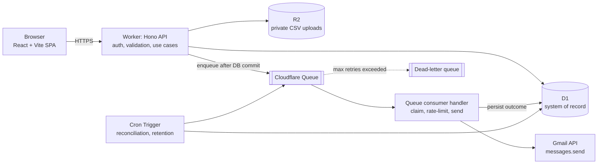

# Sendrix

> **Status:** Early build. **Multi-tenant** (one database, many tenants, each with its own users). The UI is connected to a real local API for **Contacts, Campaigns and CSV imports**. Each tenant can **connect its own Gmail account** (needs Google credentials, see **Connecting Gmail**). Sign-in, tenant sign-up, launch, test send, sending and suppression are not built yet. This README is the implementation plan derived from `email_campaign_platform_project_brief_v2.pdf` (prepared 6 Nov 2026). Section 12 records the decisions made so far (multi-user, Cloudflare Access, service-account Gmail auth, global contacts, one-time import with a 500/day drip send) and the items that are still open.

Sendrix is a web application that imports client contacts from CSV files, lets users build email campaigns, and sends **one individually addressed email per recipient** through a Google Workspace Gmail account. Sending is asynchronous, using Cloudflare Queues and Workers.

### Backend (started: Contacts and Campaigns only)

Cloudflare Worker + Hono + D1 + Drizzle, under `src/server`. Built so far: the database schema, repositories and API routes for **Contacts, Campaigns and CSV imports**, **tenants, users and access levels**, the status state machines, and a health endpoint. Not built yet: **sign-in**, tenant sign-up, user management, campaign **launch**, test-send, retry-failed, the queue, Gmail and suppression. The UI is connected to this API for Contacts, Campaigns, Campaign details, the Campaign editor and Overview (see **Running it locally**).

> **Security status:** you sign in with email and password on the login page (`/login`), or by accepting an invitation; both start a session. Every route except `/api/health`, the login and logout endpoints and the public invitation endpoints needs a session, and everything fails closed with `503 AUTH_NOT_CONFIGURED` unless `ENVIRONMENT` is `local` (set in `wrangler.jsonc`), so deploying this build cannot expose anyone's data until that is deliberately enabled. Optional local shortcut: put `DEV_ACTOR_EMAIL=admin@sabertoothsoftwarelabs.net` in `.dev.vars` and requests with no session run as that user (off by default). Roles are enforced on the user and invitation routes only so far.

#### Multi-tenancy

One database and one schema are shared by every tenant. A **tenant** is a customer organization. It owns its users, contacts, imports and campaigns, and no tenant can see or change another's.

| Table | What it holds |
|---|---|
| `tenants` | One row per tenant: `name` (unique ignoring case), `slug` (unique, URL-safe), `status` (`Active` or `Suspended`) |
| `users` | The logins. Each belongs to **exactly one tenant**. The **email is the username** and is unique across all tenants, so sign-in needs no tenant picker (the cost: one address cannot hold logins in two tenants). Holds a `password_hash`, a `must_change_password` flag, an `access_id` and a `status` (`Active` or `Disabled`) |
| `access` | The access levels: **Administrator, Campaign Manager, Viewer**. Reference data shared by all tenants, seeded by a migration with stable ids (`administrator`, `campaign-manager`, `viewer`) that match `ACCESS_LEVELS` in `src/shared/types.ts`. Each user holds one |

**How isolation is enforced, in three layers**

1. **Every tenant-owned row carries a `tenant_id`**: contacts, campaigns, campaign recipients, imports and import rows. Uniqueness is per tenant, so two tenants can each hold `jo@example.com` as separate contacts.
2. **Every repository takes the tenant and filters on it**, and the tenant comes from the signed-in user's database row, never from anything the client sends (a `tenantId` in a request body is rejected, and one in a query string is ignored). Another tenant's record does not exist as far as a caller can tell: reads find nothing and the API answers **404, not 403**, so existence is not revealed.
3. **The database refuses to cross tenants.** The foreign keys include `tenant_id`, so a recipient cannot point at another tenant's campaign or contact, an import row cannot point at another tenant's import, and a campaign or import cannot be created by another tenant's user, not even by writing SQL directly. A tenant that still owns data or users cannot be deleted.

Tests prove each layer, and a deliberately broken filter is caught (`tests/integration/tenancy.test.ts`).

**Default tenant (local development only)**

| | |
|---|---|
| Tenant | Sabertooth Software Labs |
| Username | `admin@sabertoothsoftwarelabs.net` (Administrator) |
| Password | `Password@123` (set `SEED_ADMIN_PASSWORD` to use another) |

> **This password is a development credential and is committed on purpose.** The account is flagged `must_change_password`, and the seed script only ever talks to the simulated local database, never to Cloudflare. Real tenants are created by sign-up with their own passwords. **Never seed this account into staging or production.** The repository is public, so assume anyone can read this password.

Passwords are hashed with **PBKDF2-HMAC-SHA256, a random salt per password, 100,000 iterations**, in the form `pbkdf2-sha256$iterations$salt$hash` (`src/server/lib/password.ts`). The settings travel with the hash, so the cost can be raised later. Cloudflare Workers refuse more than 100,000 iterations, which is **below current OWASP guidance for SHA-256 (600,000)**: it is the strongest the platform allows. If that is not acceptable, move to a memory-hard hash (scrypt or Argon2) in WebAssembly.

A tenant is created together with its first Administrator, atomically, by `provisionTenant` (`src/server/services/tenants.ts`). The seed script and the future sign-up flow both use it.

#### API

Everything below is scoped to the caller's tenant. All list endpoints take `page` (default 1) and `pageSize` (default 25, max 100) and return `{ items, page, pageSize, total }`. Errors always use `{ error: { code, message, details?, correlationId } }`, and the correlation ID is also the `X-Correlation-Id` header. JSON bodies are limited to 1 MB. Unknown properties are rejected, so a typo never silently drops data.

| Method + path | Purpose |
|---|---|
| `GET /api/me` | The signed-in user (email, name, access level) and their tenant. The header uses it |
| `GET /api/users` | The caller's tenant's users, with access level, status and last activity (**Administrators only**, `403 FORBIDDEN` otherwise). Read-only. Never returns password data |
| `GET /api/sender` | Whether the server can connect Gmail (`configured`) and which account the tenant has connected, if any. Never returns a token. Any signed-in user |
| `POST /api/sender/gmail/connect` | Starts "Connect Gmail": returns `{ url }`, Google's consent screen. **Administrators only**. `503 GMAIL_NOT_CONFIGURED` without Google credentials |
| `DELETE /api/sender` | Disconnects the account and asks Google to cancel its token. **Administrators only** |
| `GET /api/sender/gmail/callback` | **Public.** Where Google sends the browser back. Redirects to `/settings?sender=connected` or `?sender=error&reason=<code>` |
| `GET /api/contacts` | List. Filters: `q` (name, title, company, email), `industry`, `consent` |
| `POST /api/contacts` | Create. Email is trimmed and normalized. A duplicate **within the tenant** returns `409 EMAIL_EXISTS` with the existing `contactId` |
| `GET` / `PATCH` / `DELETE /api/contacts/:id` | Read, partial update (a changed email is re-normalized), delete. Campaign history keeps its snapshot |
| `GET /api/contacts/industries` | Distinct, non-empty industries (for the filter dropdown) |
| `POST /api/imports` | **Upload a CSV** (`multipart/form-data`: `file` and `mapping`, JSON `{ "email": 4, "firstName": 0, ... }`). The server parses and validates it itself, creates the contacts that do not exist, records every row, and answers `201` with the authoritative counts |
| `GET /api/imports` · `/api/imports/:id` | Import history and one import |
| `GET /api/imports/:id/rows` | Row results, paginated. Filters: `outcome`, `show=rejected` |
| `GET /api/imports/:id/rejected-rows.csv` | Download of every rejected row (formula-injection safe) |
| `GET /api/campaigns` | List summaries (no bodies) with recipient counts. Filters: `status`, `q`, `archived=exclude\|include\|only` |
| `POST /api/campaigns` | Create a Draft. Status and owner cannot be set by the client. `recipientImportId` must be a Completed import, or null for all contacts |
| `GET /api/campaigns/:id` | Full campaign with `totals` (recipient counts by status) |
| `PATCH /api/campaigns/:id` | Edit a **Draft** only (`409 CAMPAIGN_LOCKED` otherwise) |
| `DELETE /api/campaigns/:id` | Delete a Draft only. Archive anything else |
| `POST /api/campaigns/:id/duplicate` | New Draft with the same content and schedule, no recipients |
| `POST /api/campaigns/:id/archive` · `/unarchive` | Hide or restore. Refused while Queuing, Queued or Sending |
| `POST /api/campaigns/:id/pause` · `/resume` · `/cancel` | State changes through the state machine (`409 INVALID_TRANSITION` if illegal). Cancel also cancels unsent recipients atomically. Already-accepted mail cannot be recalled |
| `GET /api/campaigns/:id/recipients` | Recipients in send order. Filters: `status`, `q` |

#### CSV import behaviour

- **The server is the authority.** The browser previews with the same code (`src/shared/csv.ts`), but the file is uploaded and parsed again on the server when you confirm, and the server's counts are the ones saved. The UI says so if they ever differ.
- **Limits:** `.csv` only, 10 MB, 20,000 rows. A binary file renamed to `.csv`, an unclosed quote, or a header with no data is refused with `422 INVALID_CSV` and records nothing. Over the size limit returns `413`.
- **Contacts are unique per tenant.** An address that already exists in the tenant (matched ignoring letter case and surrounding spaces) is skipped and **never overwritten**. The same address in another tenant is a different contact and is not touched. Re-uploading the same file creates nothing, so a failed or repeated import is safe.
- **Nothing is silently dropped.** Rejected rows keep their row number, the cell text (cut to 500 characters) and the reason, and can be downloaded from the import history at any time.
- **Not atomic across a whole file** (D1 writes are atomic per batch, a file is many batches). If it fails midway the import is marked `Failed`, the contacts saved so far are kept, and uploading the file again finishes the job. A crash leaves the import visibly `Processing`.
- **Fast enough for your list.** Bulk writes send each chunk of rows as one bound JSON array that SQLite expands, which keeps clear of D1's 100-parameter limit. An 8,000-row file imports in about 1.5 seconds locally (the first approach, small multi-row inserts, took 15 seconds). Each import logs its phase timings, with no addresses or file content.
- **The original file is not kept.** It is parsed in the same request, so nothing needs storing. R2 would only be needed to edit the column mapping after upload.

#### Connecting Gmail

Each tenant connects **its own Google account** to send from. The Administrator opens **Settings > Email Service** and presses **Connect Gmail**:

1. The browser asks the server to start (`POST /api/sender/gmail/connect`), and is sent to Google's consent screen.
2. The person approves. Google redirects the browser back to `<APP_BASE_URL>/api/sender/gmail/callback` with a one-time code.
3. The Worker exchanges the code for tokens, **checks that the permission to send email was actually granted** (Google lets people untick it), and requires a long-lived refresh token.
4. It reads the account's **verified** email address from Google.
5. It stores the refresh token **encrypted** and records the address. That account is now the tenant's campaign sender, and the browser lands back on Settings with a confirmation. Any failure lands there too, with a plain-words explanation.

What is stored, and how it is protected:

- **Only the refresh token**, encrypted with AES-256-GCM under `TOKEN_ENCRYPTION_KEY` (a Worker secret, never in the database). Short-lived access tokens are not stored: they expire within the hour and are minted again from the refresh token when sending.
- The ciphertext is **bound to its tenant**, so a token copied into another tenant's row cannot be decrypted there (tested).
- The `state` value that ties the callback to the click is stored only as a **hash**, expires after 10 minutes, and works **once** (a replayed callback is refused). PKCE (S256) is used on top of the client secret. Only the latest attempt per tenant stays valid.
- The callback is public (Google calls it, not the app), so it trusts nothing in the request except that `state`. The attempt it matches, not the request, decides which tenant it is for. It only ever redirects to `APP_BASE_URL`, with a result code from a fixed list.
- Tokens, codes, `state` values and email addresses are never logged. The API never returns a token.
- **Disconnect** deletes the account and asks Google to cancel the token. Reconnecting replaces it in place and cancels the old one. One sender per tenant for now.
- Only **Administrators** can connect or disconnect. Everyone signed in can see which account is connected, because the campaign editor needs it. A campaign cannot be launched without a connected sender.

Sendrix asks for exactly three permissions: `openid`, `email` (to learn which address was connected) and `gmail.send` (to send). It never asks to read the inbox.

**Setting up Google (needed once per environment, by whoever runs Sendrix)**

1. In the [Google Cloud console](https://console.cloud.google.com/), create a project and enable the **Gmail API**.
2. **APIs & Services > OAuth consent screen:** choose **External** (tenants are other organizations). Add the three scopes above. While the app is in **Testing**, only the test users you list can connect, and Google expires their refresh tokens after **7 days**, which is fine for development.
3. **Credentials > Create credentials > OAuth client ID > Web application.** Under *Authorized redirect URIs* add exactly `http://localhost:5173/api/sender/gmail/callback` for local development. Add the matching `https://<your-domain>/api/sender/gmail/callback` for each deployed environment.
4. Copy `.dev.vars.example` to `.dev.vars` (git-ignored) and fill in `GOOGLE_CLIENT_ID`, `GOOGLE_CLIENT_SECRET` and `TOKEN_ENCRYPTION_KEY` (`openssl rand -base64 32`). Restart `npm run dev:api`. For staging and production use `wrangler secret put` (see section 13.5).
5. **Before real customers use it:** `gmail.send` is a *sensitive* scope, so Google requires the app to be **published and verified** (a privacy policy, a demo video, a review) before people outside your test list can connect without a warning. Check Google's current requirements in the console, and plan time for the review.

> **Not yet verified against real Google.** The whole flow is built and tested against a stand-in for Google's endpoints (including PKCE, denied consent, an unticked permission, no refresh token, replays and races), but it has not run against Google's real service, because that needs your OAuth client. Expect to find small differences the first time you connect a real account, and tell me.
>
> **Sending itself is not built.** Connecting stores the account. Nothing sends email yet.
>
> **If it says "not configured" after you added the credentials,** an old dev server is probably still answering. On Windows, stopping a terminal does not always stop its worker, and a new server can start on the same port while the old one keeps replying with its old settings. `npm run dev:api` now checks the port first and tells you; find the process with `Get-NetTCPConnection -LocalPort 8787 -State Listen` and stop it.

#### Inviting users (built)

Decided: sign-in is **app-managed** (email and password). People sign in on the login page; accepting an invitation also signs them in.

1. **Settings > Users & access > Add user.** An Administrator enters first name, last name, email address, a role (Administrator, Campaign Manager or Viewer) and, optionally, a **position** (job title, up to 100 characters). The position is kept with the invitation, survives a resend, and becomes the new user's position when they accept (a removed user invited again takes the new invitation's position). It is not shown on the public invitation page.
2. **Sendrix emails the invitation** through the tenant's connected Gmail account (decision D-28), so Gmail must be connected first. The email is plain text plus an HTML version: "{Tenant Name} has invited you to Sendrix", with an **Accept invitation** button and the plain link.
3. **The person opens `/invite/<token>`** (a public page outside the app layout), sees who invited them, and chooses a password (8 to 256 characters, typed twice).
4. **Accepting activates them** as a user of that tenant with the invited role, signs them in, and sends them to the dashboard.

How it is kept safe:

- The link holds a 32-byte random secret. **Only its SHA-256 hash is stored**, so a database leak cannot be used to accept an invitation. It is valid for 7 days and works once.
- Every unusable link (unknown, tampered, expired, used, revoked, suspended tenant) gets the same `404 INVITATION_INVALID`, so nothing can be learned by guessing.
- Accepting is **one atomic D1 batch** (create user, mark invitation accepted, start session): two simultaneous clicks make one user. A wrong or short password is rejected first, so a typo does not use the link up. An address that already has an account gets `409 EMAIL_EXISTS` and the invitation stays usable.
- The tenant and role come from the invitation row, never from the request. Unknown fields are rejected.
- One open invitation per address per tenant: **resend** issues a new link and the old one stops working; **revoke** kills it. A person cannot be mailed twice within 60 seconds, and a tenant can have at most 50 open invitations.
- Inviting an address that belongs to another tenant answers a generic `CANNOT_INVITE`, so the API does not reveal who uses Sendrix.
- If the email cannot be sent, the invitation is withdrawn again (no phantom entries). If Google rejects the stored token, the connection is flagged "Needs reconnecting" and the Administrator is told.
- **Sessions:** cookie `sendrix_session` (`HttpOnly`, `SameSite=Lax`, `Secure` on https, 30 days that restart each time the app is used), only a hash stored in the `sessions` table. A disabled user or suspended tenant is refused, never silently downgraded. `POST /api/auth/logout` ends the session; the header shows **Sign out** when the session is real.
- **Cross-site writes:** a POST, PATCH or DELETE whose `Origin` is not `APP_BASE_URL` is refused with `403 BAD_ORIGIN`.

**Removing a user** (Settings > Users & access > Remove, Administrators only) is a **soft delete**: `users.is_deleted` is set (with `deleted_at`) and nothing is erased, so what the person created keeps its owner and the email stays reserved. Removed users are not listed, all their sessions end at once, and they cannot sign in. You cannot remove yourself, and the last active Administrator cannot be removed (the rule is inside the UPDATE, so two Administrators removing each other at once cannot both succeed). A removed person can be **invited again**: accepting clears `is_deleted` on the same account (new password, name and role from the new invitation) instead of creating a second one. An address removed from a different tenant still cannot be invited here.

**Signing in** (`/login`): email and password, a Show/Hide toggle, and an optional `?next=` to return to the page you were heading for (only in-app paths are honored). Anyone not signed in who opens the app is sent to the login page. **Logout** in the header's user menu ends the session. Every wrong answer (unknown address, wrong password, a removed user) is the same `401 INVALID_CREDENTIALS` after the same amount of work, so it cannot be used to find out who has an account. **Your own settings:** the round initials button in the header opens a menu with **Settings** and **Logout**. Settings (`/account`, titled "My settings") has two tabs:

- **User Details**: first name, last name and **position** (job title: optional, up to 100 characters, can be cleared). Email and role are shown read-only; the name shown around the app follows. The position is also listed in Settings > Users & access.
- **Account Details**: change your password. It needs the current password, applies the same length rules, and refuses reusing the current one. Wrong current passwords are throttled (5 in 15 minutes, separately from sign-in). A successful change ends your **other** sessions, keeps this one, and clears `must_change_password`.

These are `PATCH /api/me` and `POST /api/me/password`; they only ever act on the signed-in user. (Company details are under **Settings** in the sidebar, for Administrators: see below.)

**Settings (sidebar, `/settings`) is for Administrators only.** Everyone else does not see the menu item, and opening `/settings` sends them back to the start page. It has three tabs, in this order: **Company Details**, **Users & access**, **Email Service**. It opens on Company Details (or on Email Service when Google sends the browser back from Connect Gmail).

**Company Details** (a Settings tab): the organization's **Name**, **Website** and **Postal address** (a multi-line text; it is added to the footer of every email, see "Compliance in sending" below, and replaces the separate "sender postal address" the old Compliance tab had). `PATCH /api/tenant` (Administrators only): send any or all of `name`, `website`, `postalAddress`, saved all-or-nothing. The name must be unique ignoring letter case; the website is a domain or http(s) address such as `example.com` (no spaces, no other schemes, up to 200 characters, stored as typed, trimmed) and may be cleared; the address may be cleared; the slug never changes. Stored in `tenants.postal_address` and `tenants.website`, and returned in `/api/me`.

**Email Service** (a Settings tab) holds everything about how email goes out, in one place, as equal-width sections in two columns (Gmail sender | test-send allowlist, then unsubscribe and compliance | sending limits, then suppression list | data retention; one column on a phone): the **Gmail sender** and the **test-send allowlist**, **Unsubscribe and compliance** (the two options below), the **sending limits**, the **suppression list** and **data retention**. This replaces the old Sender, Sending limits, Compliance and Data retention tabs. Sending limits, the suppression list and data retention are still previews that do not save yet (the page says so).

#### Compliance in sending (built)

Each organization has two options, **both ticked for every organization by default** (new ones and existing ones: `tenants.require_unsubscribe_link` and `tenants.one_click_unsubscribe`, default 1). An Administrator changes them under Settings > Email Service > Unsubscribe and compliance (`PATCH /api/tenant`, `requireUnsubscribeLink` and `oneClickUnsubscribe`, true or false; both are also in `/api/me`). The email-building code applies them, and the editor's preview uses the same code:

- **Require an unsubscribe link in every campaign:** when ON, every email automatically ends with the **standard unsubscribe footer** (below), so no campaign can go out without a working unsubscribe link and nothing has to be checked or refused. The footer cannot be edited or removed. Turn the option off and the footer is not added (the organization then takes responsibility for its own link).
- **Add one-click List-Unsubscribe headers:** every email carries `List-Unsubscribe: <address>` and `List-Unsubscribe-Post: List-Unsubscribe=One-Click` (RFC 8058), so mail apps can show their own Unsubscribe button. The address is the recipient's own one-click endpoint (`POST /api/unsubscribe/:token`, see "Unsubscribing" below). `buildMime` refuses anything that is not a plain http(s) address. Turn the option off and neither header is added.
- **Postal address in every footer:** the company's postal address from Company Details is added as the last thing in every email (HTML and plain text), after the body, the signature and the standard footer. It replaces the placeholder address the starting body used to carry. With no address nothing is added, and the editor will not let a campaign launch until the company has one (an Administrator is told where to add it; others are told to ask one).

Test sends already go through all three, so they are what a real send will be. The bulk sender, when built, must build each message with `composeEmailHtml`, a signed token per recipient and `buildMime` the same way (see "Unsubscribing").

#### The structure of an email, and the standard footer (built)

A campaign's **Message** section has two parts you write, and an email is always built in this order:

1. **Email body**: just the message (the starting body is only the greeting and the pitch). Written in a rich-text editor (see below).
2. **Email signature**: written in a rich-text editor too, and added automatically right after the body (see below).
3. **The standard footer**: added automatically after the signature. It is the same for every email, **not editable**, and not a campaign field at all (an earlier editable Footer field was removed, and `campaigns.footer` dropped):

   ```html
   <hr/>
   <p style="font-size:12px;color:#666;">
   You're receiving this email because we believe our services may be relevant to your business.<br/>
   <a href="{{unsubscribeUrl}}">Unsubscribe</a><br/>
   {company name}
   </p>
   ```

   The last line is the **sending company's** name (Company Details), written in by the system: it is not the `{{companyName}}` merge field, which in a body means the recipient's company. `{{unsubscribeUrl}}` becomes that recipient's own link. The footer is added only while "Require an unsubscribe link in every campaign" is on (the default).
4. The company's **postal address** (Company Details), a small grey line after all of that, as a legal requirement (see "Compliance in sending").

Merge fields work in the body and the signature. The editor's preview and test sends use the same `composeEmailHtml`, so the preview is what is sent (the preview's unsubscribe link is a placeholder).

#### Unsubscribing (built)

Every email's unsubscribe link, and every `List-Unsubscribe` header, carries a **signed token** for that one recipient (`src/server/lib/unsubscribe.ts`): the tenant, the address and the campaign, signed with HMAC-SHA256 keyed from `TOKEN_ENCRYPTION_KEY` (with its own purpose label). It cannot be forged or altered, there is nothing to look up or guess, and it never expires (a link in an old email must keep working). If the server has no valid key, nothing is signed and the endpoints answer `503`.

| Address | What it does |
|---|---|
| `GET {APP_BASE_URL}/unsubscribe/:token` | **The page** the link in the email body opens (a public React page outside the app layout). It asks first ("Unsubscribe from {company}?", with the address masked as `a***@example.com`) and only unsubscribes when the person presses the button, so a mail scanner that opens every link unsubscribes nobody |
| `GET /api/unsubscribe/:token` | What the page shows: company, masked address, whether already unsubscribed. **Changes nothing** |
| `POST /api/unsubscribe/:token` | **Unsubscribes.** This is also the address in the `List-Unsubscribe` header: mail apps POST `List-Unsubscribe=One-Click` here, so the body is ignored. Public, no session, and exempt from the same-site check (mail providers POST from their own servers; the signed token is what authorizes it) |
| `GET /api/suppressions` | The suppression list, newest first, paged (Administrators only, read-only) |

- **What unsubscribing does:** one atomic batch puts the address on the tenant's **suppression list** (`suppressions` table, one row per address per tenant, never emailed again) and marks the contact, if there is one, `Withdrawn` with source "Unsubscribe link". It is **idempotent** and **per organization**: the same address stays reachable by other organizations. It still works for a suspended organization: people can always opt out.
- **Every bad link gets the same answer:** unknown, tampered, wrong key, junk, too long, a deleted company: `404 UNSUBSCRIBE_INVALID` ("This unsubscribe link is not valid"), so nothing can be learned by guessing.
- **Test emails:** each recipient of a test gets their own link too, but it is a **test token**: it opens the real page, which says "This is a test email" and offers nothing to press; the endpoint changes nothing, so the allowlist address is never suppressed.
- **Settings > Email Service > Suppression list** now shows the real list.
- **Still to do:** the bulk sender must check the suppression list when it selects recipients and again just before each send (D-07), and must mint a live (non-test) token per recipient with `createUnsubscribeToken` and `unsubscribeLinks`. Until launch is built nothing sends to real recipients, so nothing can yet be sent to a suppressed address.

#### Rich-text editors for the body and the signature (built)

Under **Message > Edit**, the email body and the email signature are written in rich-text editors (TipTap, on ProseMirror: `src/client/components/RichTextEditor.tsx`) instead of plain boxes. The Edit and Preview tabs are unchanged, and Preview shows the formatting as it will be sent.

- **Toolbar (body):** text style (paragraph, heading 1 to 3), bold, italic, underline, strikethrough, link, bulleted and numbered lists, quote, horizontal line, left/center/right alignment, clear formatting, undo and redo. The **signature** has a shorter one (no headings, lists, quote or line). The body also has the merge-field buttons (`{{firstName}}` and the rest) in a row **above** the field, each light yellow like a warning; they insert the tag where the cursor is. Merge fields in the text of either editor are **highlighted** the same light yellow once they are there (a red highlight marks one that is not recognised, a typo that will not be filled in). The highlight is only how the text looks on screen: nothing is added to the saved or sent HTML.
- **Links:** select text, press **Link**, type an address and Apply (or Enter). `https://`, `http://`, `mailto:` and `tel:` are accepted, and so is a merge field such as `{{unsubscribeUrl}}` (so the unsubscribe link can be made). `javascript:` and other schemes are refused with a message.
- **Stored as HTML** in `campaigns.html_body` and `campaigns.signature`. An empty editor is stored as an empty string, not `<p></p>`, and a trailing empty paragraph is not stored. A body or signature that is only spaces counts as empty ("Email body is required").
- **HTML button:** switches that field to its raw HTML for hand-written markup. What is typed there is kept **exactly as typed**.
- **What the editor can and cannot hold:** it keeps what email can show (the toolbar's formatting). Anything else in HTML it is given (tables, styles, scripts, event handlers, images) is not part of its model: it is not shown, and it is dropped the first time that field is **edited in the editor**. **Opening and saving a campaign without editing a field leaves its HTML exactly as it was**, so older campaigns with custom markup are not altered by merely opening them; use the HTML button to keep or edit such markup. The editor also never loads scripts or event handlers into the page.
- **Plain-text part:** made from the final HTML, with link addresses kept and list items as dashes.
- **Tests:** the editor itself (formatting, links, undo, source view, merge buttons, unsafe markup), both fields in the campaign form, and the data migration are covered. Tests drive a field through its HTML view (`tests/ui/rte.ts`), and `tests/ui/dom-polyfills.ts` stubs the layout methods jsdom lacks.

#### Email signature (built)

A campaign has an **Email signature** (the sign-off) instead of a plain-text body field. It is **HTML** written in the rich-text editor, up to 5,000 characters, stored on the campaign (`campaigns.signature`, edited with the draft). Signatures saved before the rich-text editor were plain text; migration 0015 turned each into the same text as an HTML paragraph (escaped, line breaks kept), so they look exactly as they did.

- **Starting text:** a new campaign's signature is filled in from the signed-in user and their company, and can be edited freely:

  ```
  Best regards,
  {full name of the logged-in user}
  {position of the logged-in user} | {company name}
  {company website}
  ```

  With no position the line is just the company name; with no website that line is left out. It starts as one paragraph with those lines, and can then be formatted like any text. An existing draft keeps its own signature (even an empty one).
- **Where it goes:** always right after the body (see "The structure of an email" above). With no signature (or an empty editor) nothing is added. It is sent as the HTML written, and merge fields in it are filled in like the body's. An old `{{signature}}` tag left in a body is simply removed, so it can no longer move the signature.
- **Preview and test sends** use exactly the same rule, so the preview shows the signature. The plain-text part of an email is always made from the final HTML, so both parts say the same; the old `text_body` column is still there but is no longer used.

**Stay signed in:** a session lasts 30 days from its last use. The cookie is persistent (it survives closing the browser) and every time the app is used the 30 days start again, with the cookie re-issued; the database is written at most once an hour per session. Someone who does not use the app for 30 days is signed out. There is no absolute cap on how long an actively used session can last. **Throttling:** 5 failures for one address within 15 minutes lock that address for 15 minutes (even the right password is refused, with `429 TOO_MANY_ATTEMPTS` and `Retry-After`); 30 failures from one network address lock that address. Unknown addresses are counted too, a good sign-in clears the count, and the counters live in the `login_attempts` table (no passwords). A disabled user or suspended organization is told so only after giving the right password.

Still not built: a forced password change for accounts flagged `must_change_password` (the login response reports the flag, nothing acts on it yet), password reset, changing a user's access or disabling (without removing) them, and enforcing roles on every route. The default development admin is flagged, so it signs in normally.

#### Test sends (built)

Every test email from a campaign goes to the **test-send allowlist** (Settings > Email Service), and nowhere else.

- **The list:** per organization, up to 20 addresses, one row each in `test_recipients` (case-insensitive, no duplicates). Administrators add and remove addresses; everyone signed in can see it, so the editor can show who a test will reach.
- **The button:** *Send test email* in the campaign editor saves the draft first (so the test is exactly what is on screen), then asks the server to test-send it. The request carries **no addresses**: the server reads the list itself, so a test cannot be aimed anywhere else, whatever a client sends. With an empty list the button is off and says why.
- **The message:** one email per address, through the organization's connected Gmail account, with `[TEST] ` in front of the subject. The **sender name** recipients see is the **full name of the logged-in user who sends it** (their display name, first and last; a user with no name falls back to the company's name), with the connected Gmail address behind it, so `Rico Prinsipe <sales@acme.com>`. The editor's preview shows the same From line. Real campaign sending, when built, must use the same name. Merge fields are filled in with sample data (Alex Sample, Example Co), exactly as the editor's preview does. The plain-text part is the campaign's text body, or one made from the HTML.
- **What it does not do:** it never touches the campaign's real recipients or its status, and works on any campaign. Administrators and Campaign Managers may test; Viewers may not.
- **Not yet:** test sends are not counted against the daily quota (D-23 asks for that once real sending exists), and there is no per-address delivery report: if Gmail fails part-way, the error says how many went out.

#### State machines

`src/shared/status.ts` is the single source of truth for legal status changes (campaign and recipient), shared by the API and the UI, with exhaustive unit tests. Highlights: a recipient reaches `Accepted` only from `Processing` and `Processing` only from `Queued`. `Accepted`, `Skipped` and `Cancelled` are final. Campaigns launch `Draft -> Sending`, only `Draft` is editable, and `Completed` and `Cancelled` are final. Updates are guarded by the status that was read, so two concurrent actions cannot both succeed.

#### Branding

The look comes from the logo, `src/client/assets/logo.png` (kept as supplied). Its two colours were measured from the artwork: **teal `#01a4c2`** and **navy `#091a34`**.

- **Logo:** the header, the login page and the invitation page use `src/client/assets/logo-wordmark.png`, the same artwork trimmed of its empty margin and scaled down (74 KB instead of 460 KB). The navy lettering would vanish on a dark background, so in dark mode the logo sits on a small white plate. The browser tab icon (`public/favicon.png`) is the paper plane from the logo.
- **Palette:** defined once, in the `@theme` block of `src/client/index.css`. `brand-50` to `brand-950` is the logo teal (500) with lighter tints and navy-leaning shades; it is used for buttons, links, the active menu item, focus rings, progress bars, the user circle and the invitation email's button. The neutral `slate` scale is tinted with the logo navy (`slate-900` is exactly `#091a34`), so body text, headings and dark-mode backgrounds are navy rather than grey. Status colours (green for success, amber for warnings, red for errors) are unchanged on purpose.
- **Readability:** the combinations the app uses were checked against WCAG contrast (white on the button colour 4.6:1, body text 17:1, secondary text 5:1, and the dark-mode equivalents). To change the brand, edit those two scales in `index.css`; nothing else holds a colour.
- **If the logo changes:** replace `logo.png`, then regenerate `logo-wordmark.png` and `public/favicon.png` from it (crop to the artwork, scale to 720 px wide).

#### Tests

`npm test` runs 935 tests: state machines, validation schemas, IDs, password hashing, the CSV parser, the API including tenant isolation, CSV imports up to 8,000 rows and the whole Gmail connection and invitation flow against a stand-in for Google (all on in-memory D1), the migrations, and the UI pages (rendered in a simulated browser with the network stubbed, checking they call the API correctly and handle errors, empty states and read-only roles). The integration tests run the real Hono app and repositories against an in-memory D1 database (Miniflare) built from the committed migrations, so they never touch your local dev data. `npm run typecheck` covers the front end, the server, the server-side tests and the UI tests (the last two use separate configs, because browser and Cloudflare Worker types define clashing globals).

| Table | Purpose |
|---|---|
| `tenants`, `users`, `access` | See **Multi-tenancy** above |
| `sender_accounts` | A tenant's connected Gmail account: the address, status (`Connected` or `NeedsReconnect`), the **encrypted** refresh token, the scopes granted, who connected it. One per tenant |
| `oauth_states` | One row per in-flight "Connect Gmail" attempt: a **hash** of the `state`, the encrypted PKCE verifier, an expiry, and a used-at stamp |
| `contacts` | A tenant's contacts, one row per `normalized_email` **within the tenant**. Columns follow `template.csv` |
| `campaigns` | A tenant's campaigns: content, status, creator (a user of the same tenant), and the daily-drip settings (`daily_limit`, send window, timezone, `next_run_at`) |
| `imports` | One row per CSV upload by a tenant's user: filename, size, the confirmed column mapping, and the server's authoritative counts (valid, created, already existing, rejected by reason). Status is Processing, Completed or Failed |
| `import_rows` | The outcome of **every** CSV row: `Created`, `Existing` (both linked to a contact), or rejected (`Blank`, `Malformed`, `Duplicate`, `Bad row`). The rows linked to a contact are exactly the recipients of "this import" |
| `campaign_recipients` | One row per (campaign, contact) with an email and merge-field snapshot, a stable `sequence`, status and lease. Included now because it is the link between the two |

Design points: UUIDv7 text IDs, UTC millisecond integer timestamps, enums as `TEXT` with `CHECK` constraints (values live in `src/shared/types.ts`). `created_by` on campaigns and imports is a real foreign key to the creating user (and the API shows that user's email). `campaigns.recipient_import_id` (null = every contact of the tenant, otherwise the people in that import) is saved with the draft and resolved into `campaign_recipients` at launch.

Foreign keys that include `tenant_id` cannot use `ON DELETE SET NULL` (SQLite would also null the required `tenant_id`), so **erasing a contact clears its links first, in one atomic batch** (`contactsRepo.delete`): recipients and import rows keep their snapshots and lose only the link. `contacts.source_import_id` and `campaigns.recipient_import_id` stay soft references (no foreign key), and the API checks the import is the tenant's own and Completed.

**The multi-tenancy migration (`0002`)** drops and recreates the five tenant-owned tables, because SQLite cannot add a required `tenant_id`, change a unique key or add composite foreign keys to an existing table. That is only safe while they are empty, so the migration **aborts without changing anything if any of them holds a row** (tested). Clear the data on purpose first (`npm run db:clear:local`), or write a data-preserving migration. Never edit a migration that has been applied.

```bash
npm run db:generate          # after editing src/server/database/schema/*, creates a migration
npm run db:migrate:local     # apply to the local D1 database (.wrangler/state)
npm run db:seed:tenant:local # create the default tenant and its Administrator (safe to run twice)
npm run db:clear:local       # delete ALL tenants, users, contacts, campaigns and imports (keeps tables and the 3 access levels)
npm run db:reset:local       # clear, then seed the default tenant again
npm run dev:api              # Worker on http://localhost:8787, try /api/health
npm run cf-typegen           # regenerate worker-configuration.d.ts after editing wrangler.jsonc
npm run typecheck            # front end and server
```

`wrangler.jsonc` holds placeholder database IDs for staging and production. Replace them with the IDs printed by `wrangler d1 create`.

### Running it locally

Two terminals, then open http://localhost:5173:

```bash
npm install
npm run db:migrate:local   # once, and after each new migration
npm run db:seed:tenant:local   # once: the default tenant and admin (see Multi-tenancy). Sign in at /login as admin@sabertoothsoftwarelabs.net / Password@123
cp .dev.vars.example .dev.vars   # optional: Google credentials, to try Connect Gmail (see Connecting Gmail)
npm run dev:api            # terminal 1: the API (wrangler dev, http://127.0.0.1:8787). Refuses to start if the port is taken
npm run dev                # terminal 2: the UI (Vite). Vite proxies /api to the API
npm run seed:local         # optional sample data for the default tenant: imports the 25 contacts in public/sample-contacts.csv and creates one sample draft
```

The seed script imports `public/sample-contacts.csv` through the real import endpoint, and is safe to run twice. It refuses to talk to anything but a local API.

**What is live and what is still a preview**

| Area | Status |
|---|---|
| Contacts: list, search, filters, add, edit, delete | **Live** (API + D1) |
| Campaigns: list, create, edit draft, duplicate, archive, delete draft | **Live** |
| Campaign details: totals, recipients, pause, resume, cancel | **Live**. Refreshes every 10 seconds while a campaign is Sending |
| Overview | **Live**, derived from the campaigns list (there is no dashboard endpoint yet) |
| Imports (CSV): upload, map, review, confirm, history, rejected-rows download | **Live**. The browser previews, the server imports and answers with the real counts |
| Campaign recipients (all contacts, a saved import, or upload a CSV there) | **Live and saved with the draft**. A CSV chosen in the editor is validated and mapped there, then imported with the **Import N contacts and use them** button. The recipient list itself is built at launch, which is not built yet |
| Settings > Email Service > Test-send allowlist, and the editor's **Send test email** | **Live**. See "Test sends" below |
| Launch, retry failed | Not built. The launch dialog saves a draft and says so |
| Header: tenant name and signed-in user | **Live** (`/api/me`) |
| Settings > Email Service: Connect Gmail, reconnect, disconnect | **Live**, once the Google credentials are supplied. Until then it says it is not set up. Not yet tried against real Google |
| Campaign editor sender | **Live**: shows the tenant's connected address and blocks launching without one |
| Settings: sending limits, data retention | Preview only. The mock records were removed: everything starts empty and nothing is saved |
| Settings: unsubscribe options, suppression list, the public unsubscribe page and endpoint | **Live**. See "Unsubscribing" above |
| Settings > Users & access | **Live, read-only**: lists the tenant's real users and the three access levels. **Add user** and the role selectors are visible but do nothing yet (see below) |
| Sign-in, tenant sign-up, password change | Not built. Locally the API acts as the seeded Administrator |
| Role enforcement | Not built. The UI shows or hides controls by your real access level (there is no longer a "Preview as" switch). The API enforces roles only on the user and invitation routes so far |

The UI talks to the API through `src/client/services/` (a small typed client plus TanStack Query hooks). Request and response shapes come from `src/shared/`, so the UI and server cannot drift apart. The CSV parsing and validation (`src/shared/csv.ts`) runs in the browser for the preview and in the Worker as the authority.

If the API is not running, pages show "Could not reach the API. Start it with `npm run dev:api`".

---

## Table of Contents

1. [Goals, Scope and Non-Goals](#1-goals-scope-and-non-goals)
2. [Feature Catalog (MVP vs Post-MVP)](#2-feature-catalog-mvp-vs-post-mvp)
3. [Technology Stack](#3-technology-stack)
4. [System Architecture](#4-system-architecture)
5. [Database Design](#5-database-design)
6. [State Machines](#6-state-machines)
7. [Key Subsystems](#7-key-subsystems) (Import, Email/Gmail, Queue, Security)
8. [API Surface](#8-api-surface)
9. [Development Conventions](#9-development-conventions)
10. [Project Structure](#10-project-structure)
11. [Implementation Phases](#11-implementation-phases)
12. [Architectural Gaps and Open Decisions](#12-architectural-gaps-and-open-decisions)
13. [Setup Instructions](#13-setup-instructions)
14. [Acceptance Criteria](#14-acceptance-criteria)
15. [References](#15-references)

---

## 1. Goals, Scope and Non-Goals

**Primary goals**

- Import `.csv` contact lists that follow the `template.csv` columns (see [CSV data structure](#csv-data-structure)). Email is the only required column. The same upload is available when creating a campaign.
- Validate, normalize and deduplicate addresses, with every rejected row reviewable and downloadable.
- Create campaigns (name, subject, rich-text email body and signature, sender, recipients) with preview and test-send.
- Send each recipient a separate message. No shared To/CC/BCC.
- Send asynchronously, so no browser request stays open while mail is sent.
- Track Pending, Queued, Processing, Accepted, Failed, Skipped and Cancelled states, with retries and a full attempt audit trail.
- Provide a dashboard and campaign detail view with progress and sanitized errors.

**Assumptions (from the brief)**

- Internal business-outreach tool, not multi-tenant SaaS.
- One Workspace mailbox initially; provider/account abstractions leave room for more.
- D1 (SQLite) is the database. PostgreSQL is not to be substituted without the owner's explicit decision.
- Cloudflare Workers, D1, Queues and R2 are the infrastructure foundation. No VPS or always-on server.
- Credentials are supplied later. Only placeholders are scaffolded. Nothing is invented or committed.

**Non-goals for v1**

- Marketing automation, lead scoring, CRM, complex segmentation.
- Guaranteed inbox delivery. Gmail API acceptance is not delivery, so the UI says **"Accepted by Gmail"**, never "Delivered".
- High-volume bulk sending. Gmail Workspace limits apply. Move to a dedicated ESP if volume grows.
- Drag-and-drop email designer.

---

## 2. Feature Catalog (MVP vs Post-MVP)

| Feature | Tier | Notes |
|---|---|---|
| Dashboard (KPIs, recent campaigns, queue health) | MVP | |
| CSV import (column map, preview, validate, dedupe, invalid-row download) | MVP | Follows `template.csv`. Parsed in the browser in the mock UI |
| Upload a CSV while creating a campaign (alternative to picking an existing import) | MVP | Same validation as Imports. The upload becomes an import and its contacts are saved globally |
| Contact management (search, filter, edit, source import) | MVP | |
| Campaign CRUD (create, edit, duplicate, archive drafts) | MVP | Content locks at launch (see D-12) |
| Email preview + test-send | MVP | Test-send must never enqueue the full list |
| Individual sending (1 recipient per message) | MVP | |
| Queue processing (bounded concurrency, rate limits, retries, DLQ, idempotency) | MVP | |
| Campaign monitoring (progress, per-recipient status, attempts, errors, message ID) | MVP | |
| Failure recovery (explicit, auditable retry) | MVP | |
| Settings (mailbox status, OAuth connect/reconnect, sending limits, health) | MVP | |
| Security (auth, roles, private R2, secrets, audit events for launch and account changes) | MVP | |
| Suppression / unsubscribe | **MVP, recommended** | Brief marks it "strongly recommended" and lists it as an open decision (D-07) |
| Pause / cancel | MVP | Brief marks it "where feasible" |
| Resume | Post-MVP | |
| Reusable templates | Post-MVP | `email_templates` table optional |
| Merge fields beyond `firstName`/`companyName` | Post-MVP | Basic merge fields are MVP |
| **Daily drip sending** (cap of N per day, e.g. 500, until the list is exhausted) | **MVP** | Core requirement, see §7.5. Replaces generic scheduling for v1 |
| Scheduling (arbitrary future date/time) | Post-MVP | Needs Cron Triggers |
| Segmentation / tags | Post-MVP | |
| Attachments | Post-MVP | |
| CSV exports of results | Post-MVP | Invalid-row report is MVP |
| Multiple sender accounts | Post-MVP | Schema is designed for it now |
| Analytics, notifications | Post-MVP | |
| Full audit history UI | Post-MVP | MVP records the events |

**Screens:** Overview, Imports, Contacts, Campaigns, Campaign editor, Campaign details, Templates (post-MVP), Settings.

**Roles:** *Administrator* (everything, plus users, settings, sender connection), *Campaign Manager* (import, manage contacts and campaigns, test-send, launch, monitor), *Viewer* (read-only).

---

## 3. Technology Stack

| Layer | Choice | Responsibility |
|---|---|---|
| Language | TypeScript (strict) | One language across UI, API and queue consumer |
| Frontend | React + Vite | SPA, served via Workers static assets |
| Styling | Tailwind CSS | |
| API runtime | Cloudflare Workers | Serverless; no always-on process |
| API framework | Hono | Routing, middleware, validation |
| Database | Cloudflare D1 | Managed SQLite; system of record |
| ORM/migrations | Drizzle ORM + Drizzle Kit (`drizzle-orm/sqlite-core`) | Typed schema and migrations |
| Async jobs | Cloudflare Queues + consumer handler | Recipient-level email jobs, DLQ |
| Object storage | Cloudflare R2 (private) | Uploaded CSV files, generated reports |
| CSV parsing | Small in-repo RFC 4180 parser (`src/client/lib/csv.ts`, no dependency; shared with the Worker later) | Header row, quoted fields, validation. Replaces SheetJS (see **D-04**) |
| Email | Gmail API, authenticated by each tenant's own Google account through **OAuth 2.0** (D-05, revised) | Send as the tenant's connected Gmail address |
| Validation | Zod | API payloads, env bindings, parsed rows |
| Testing | Vitest (+ Workers test pool) | Unit, service and integration tests |
| Tooling | Wrangler | Local D1/R2/Queues simulation, deploy |
| CI/CD | GitHub + GitHub Actions | Lint, typecheck, test, deploy |

Pin **current stable** versions at scaffold time, and verify Workers runtime compatibility for each dependency. Node-only libraries may need `nodejs_compat` or may not work at all.

**Hosting model:** a single Worker with static assets. Its `fetch`, `queue` and `scheduled` handlers deploy together. Split only for a concrete operational reason. Cloudflare Pages is not used.

---

## 4. System Architecture



**Principles**

1. **D1 is the system of record.** Queues are transport only. Persist the recipient job rows *before* publishing messages.
2. **At-least-once processing.** Every consumer step is idempotent, guarded by a stable key and a conditional-`UPDATE` claim.
3. **Honest status.** "Accepted" means Gmail took the message. Delivery or bounce is a separate signal, post-MVP.
4. **Thin edges.** Routes handle HTTP, services implement use cases, repositories wrap Drizzle/D1, providers wrap Gmail, and queue handlers only orchestrate. Cloudflare bindings sit behind interfaces so unit tests can fake them.

**Main flows**

- *Import:* upload to R2, create an `imports` row, parse, return a preview (headers and sample rows). The user maps columns, rows are validated into `import_rows`, and the user confirms to upsert `contacts`.
- *Launch:* validate campaign, sender, eligible recipients and compliance settings. In a batched write, create `campaign_recipients` as `Pending` and set the campaign to `Queuing`. Then `sendBatch` to the queue in chunks, mark recipients `Queued`, and set the campaign to `Queued`. If the request dies mid-way, reconciliation re-enqueues the remaining `Pending` rows.
- *Send (consumer):* validate payload, load rows, atomically claim (`Queued → Processing` with a lease), re-check suppression, campaign state and rate limit, build the MIME message, call Gmail, then record the `email_attempts` row and the recipient outcome. Retry transient errors with backoff. Mark permanent errors `Failed`.
- *Monitor:* the browser polls paginated API endpoints backed by D1 aggregates.

---

## 5. Database Design

SQLite dialect via Drizzle `sqlite-core`. Never use PostgreSQL-specific SQL.

**Conventions:** IDs are sortable and collision-resistant (UUIDv7 or ULID, see D-10). Timestamps are UTC Unix milliseconds in `INTEGER` columns (see D-10). Store original and normalized email. Normalization is `trim` plus lowercase only, with no Gmail-dot removal. Enums are `TEXT` with a `CHECK` constraint. Foreign keys are enforced. Use `db.batch()` for multi-statement atomic writes.

**Tables (proposed; the brief's list is a starting point, additions marked ➕)**

| Table | Purpose | Key columns |
|---|---|---|
| `users` | App identities (if app-managed auth) | id, email, display_name, role, created_at |
| `imports` | CSV uploads | id, file_key, original_filename, status, column_mapping (JSON), row_count, valid/invalid/duplicate/blank counts, created_by, created_at |
| `import_rows` | Row-level validation results | id, import_id, row_number, raw_email, normalized_email, validation_status, error, raw_data (JSON), contact_id |
| `contacts` | Normalized, reusable contacts | id, email, normalized_email (**UNIQUE**, global scope, D-06), first_name, last_name, title, company_name, employees, industry, linkedin_url, website, city, state, country, annual_revenue (the `template.csv` fields), source_import_id, consent_status, consent_source, created_at, updated_at |
| ➕ `suppressions` | Opted-out, bounced, complained or manually blocked addresses | id, normalized_email (UNIQUE), reason, source, created_at |
| `campaigns` | Config and aggregate state | id, name, subject, html_body, text_body, status, sender_account_id, scheduled_at, archived_at, launched_at, created_by, timestamps; **drip fields** ➕: daily_limit, send_window_start/end, timezone, next_run_at, last_run_at |
| `campaign_recipients` | Recipient-level work | id, campaign_id, contact_id, email_snapshot, **personalization_snapshot (JSON)** ➕, status, attempt_count, lease_expires_at ➕, queued_at, sent_at, last_error; **UNIQUE(campaign_id, contact_id)** |
| `email_attempts` | Audit trail of every attempt | id, campaign_recipient_id, attempt_number, outcome, provider_message_id, error_code, error_message (sanitized), attempted_at |
| `sender_accounts` | **Built** (see **Connecting Gmail**). A tenant's connected Gmail account with its encrypted refresh token. One per tenant | email, normalized_email, status, refresh_token_encrypted, key_version, scopes, connected_by, connected_at |
| ➕ `sending_limits` / `app_settings` | Per-account per-minute and daily caps, retention periods, test-address allowlist | |
| ➕ `audit_events` | Who did what (launch, retry, settings, connect) | id, actor_id, action, entity_type, entity_id, metadata (JSON, no secrets), created_at |
| `email_templates` (post-MVP) | Reusable templates | id, name, subject_template, html_body, text_body, created_at |

**Indexes:** `campaign_recipients(campaign_id, status)`, `contacts(normalized_email)` unique, `import_rows(import_id, validation_status)`, `email_attempts(campaign_recipient_id)`, `suppressions(normalized_email)` unique, `campaign_recipients(status, lease_expires_at)` for reconciliation.

**D1 constraints to design around:** D1 has no long-lived interactive transactions, so use `batch()` and conditional `UPDATE ... WHERE status = ?`. Bound-parameter and statement-size limits cap bulk inserts, so chunk them. Writes are serialized per database, so measure launch throughput at expected campaign size. D1 has no TTL, so retention needs a scheduled purge.

---

## 6. State Machines

**Campaign:** `Draft → Queuing → Queued → Sending → Completed | CompletedWithErrors | Failed`, with `Paused` (from `Queued`/`Sending`) and `Cancelled` (from any non-terminal state). The brief's §2 and §8 lists differ, so this README adopts the §8 superset (D-13).

**Campaign recipient:** `Pending → Queued → Processing → Accepted | Failed`, with `Skipped` (suppressed, invalid, quota hold) and `Cancelled`. `Processing → Queued` is allowed on lease expiry. `Failed → Queued` is allowed only through an explicit, audited retry of transient or manually approved failures.

Transitions live in one pure, unit-tested module. No code outside it may write a status directly.

---

## 7. Key Subsystems

### 7.1 CSV import
- Accept `.csv` only (UTF-8, optional BOM; CRLF, LF or CR line endings). Check the extension, size and content. A file that begins with the ZIP signature (an Excel workbook renamed to .csv) or contains NUL bytes is rejected with a hint to "Save As CSV UTF-8". Don't trust the MIME type.
- Enforce configurable limits: file size (10 MB) and row count (20,000). A real parser handles quoted fields, escaped quotes and embedded newlines.
- Column mapping is automatic for the `template.csv` headers (case and punctuation-insensitive aliases) and always editable, so a header named differently from "Email" still works. Email is the only required mapping.
- Rows with **more** cells than the header are rejected as "Bad row" (usually an unquoted comma). Rows with fewer cells are padded.
- Report blank, malformed, duplicate and bad rows by source row number (header = row 1). Duplicates are matched case-insensitively and the first copy wins. Syntax validation does not prove a mailbox exists.
- A non-numeric `# Employees` or `Annual Revenue` does not reject the row. The value is left blank and the count is reported as a warning.
- Keep invalid rows reviewable (`GET /imports/:id/rows`) and downloadable. The downloaded report neutralizes spreadsheet formula injection (cells starting with `=`, `+`, `-` or `@` are prefixed with `'`). Store the original file in private R2 under a retention rule.
- Contacts are global. On confirm, new addresses are created, and addresses that already exist keep their current details (nothing is overwritten).

#### CSV data structure

The columns of `template.csv`, in order, and where each is used:

| CSV column | Field | Required | Notes |
|---|---|---|---|
| First Name | `firstName` | No | Merge field `{{firstName}}`, fallback "there" |
| Last Name | `lastName` | No | `{{lastName}}` |
| Title | `title` | No | `{{title}}` |
| Company Name | `companyName` | No | `{{companyName}}`, fallback "your company". May contain commas when quoted |
| **Email** | `email` | **Yes** | Stored as entered and normalized (trim, lower-case). Unique per contact |
| # Employees | `employees` | No | Integer. Blank or non-numeric becomes null |
| Industry | `industry` | No | `{{industry}}`, fallback "your industry". Contact filter |
| Person Linkedin Url | `linkedinUrl` | No | Display only |
| Website | `website` | No | `{{website}}` |
| City | `city` | No | `{{city}}` |
| State | `state` | No | `{{state}}` |
| Country | `country` | No | `{{country}}` |
| Annual Revenue | `annualRevenue` | No | Whole dollars. Blank or non-numeric becomes null |

The supported merge fields are exactly: `{{firstName}}`, `{{lastName}}`, `{{title}}`, `{{companyName}}`, `{{industry}}`, `{{city}}`, `{{state}}`, `{{country}}`, `{{website}}`, plus `{{unsubscribeUrl}}`. Values are HTML-escaped. Unknown tags block launch. The CSV carries no consent column, so imported contacts start with consent "Unknown" (see D-26).

### 7.2 Email and Gmail
- **Auth: each tenant connects its own Google account through OAuth** (see **Connecting Gmail**; this replaces the earlier service-account plan, D-05). Sending will use the stored refresh token to mint a short-lived access token, then call `messages.send` as that account. The token is decrypted only at that moment and only for the tenant being sent for.
- If Google rejects the token (revoked, expired in Testing mode, password changed), the account is marked `NeedsReconnect`, the campaign pauses, and an Administrator is told to reconnect.
- Domain-wide delegation is not an option here: it only works inside one Workspace organization, and every tenant is a different one.
- Build the MIME message (To, From, Subject, MIME-Version, Content-Type, multipart/alternative), then base64url-encode it for `messages.send`.
- Escape all merge-field values inserted into HTML. Allow only a fixed placeholder set. Never execute user-supplied template code.
- From must be the authenticated mailbox or a configured send-as alias.
- Classify errors: **transient** (network, 5xx, 429/rate limit) retries with backoff. **Permanent** (invalid recipient, auth/permission revoked) fails without retry. **Auth-broken** pauses the whole campaign and alerts an admin.
- Quotas are configurable and conservative, never hard-coded. Check Google's current Workspace limits before launch. When a limit is hit, hold the campaign rather than fail recipients.

### 7.3 Queue processing and reliability
- Message payload: `{ campaignRecipientId, campaignId, idempotencyKey }`.
- Configure `max_batch_size`, `max_concurrency`, `max_retries`, retry delay and a **DLQ**. Messages that exhaust retries mark the recipient `Failed` and land in the DLQ for inspection.
- **Claim:** `UPDATE campaign_recipients SET status='Processing', lease_expires_at=? WHERE id=? AND status='Queued'`. Zero rows changed means skip and ack.
- **Rate limiting:** Queues has no native per-account limit. D-03 chooses a D1 counter or a Durable Object.
- **Reconciliation** (Cron Trigger): re-enqueue `Pending` rows older than a threshold, reset expired `Processing` leases, and complete campaigns whose recipients are all terminal. The brief lists Cron as optional, but this duty makes it effectively required (D-14).
- **Known uncertainty:** if Gmail accepts a message and the Worker dies before recording success, a retry could double-send. Gmail has no idempotency key. D-08 documents the mitigation options. The README and UI must state that exactly-once delivery is not promised.

### 7.4 Security, privacy, compliance
- Authenticate everything except the OAuth callback, health check and unsubscribe endpoint. Enforce RBAC server-side on every route.
- Use CSRF protection if cookie sessions are used. Apply input validation and upload limits.
- R2 is private. Access only through the Worker or short-lived signed URLs.
- Logs carry metadata only (campaign ID, recipient-job ID, attempt number, correlation ID). Never log bodies, tokens or unnecessary personal data.
- Track consent and source per contact. Honor suppression **at selection time and again immediately before send**.
- Define retention and deletion for uploaded CSV files, contacts, campaign content and logs. Check anti-spam and privacy laws for sender and recipient jurisdictions (CAN-SPAM, GDPR, CASL and so on). This is a legal review item, not only an engineering one.

### 7.5 Daily drip sending (one import, about 8K+ contacts, max 500 per day)

**Recommendation:** import once, store every row in D1, create all recipient rows at launch, but **enqueue only one day's batch at a time**. A daily Cron Trigger drives the schedule. Don't enqueue 8K messages up front. Queue delay limits, a long-lived backlog and awkward pause/cancel semantics make that worse, and this design makes the daily cap trivially enforceable.

**Import size.** 8K rows is small: a CSV of that size is a few MB at most. Parse it with the in-repo CSV parser (D-04), either in the browser (as the mock UI does) or in the Worker after streaming the upload to R2, under a cap of 20k rows and 10 MB. If testing shows memory problems on the Worker, split the work into chunked queue jobs. Persist rows to `import_rows` and `contacts` in chunks (D1 limits bound parameters per statement). After the import is confirmed, the CSV file can be deleted from R2 according to retention (D-21).

**Launch (once).** Validate, then create all `campaign_recipients` as `Pending` in chunked batched writes, snapshotting email and merge fields (D-12). Campaign content locks. Set `status = Sending`, `daily_limit = 500`, `next_run_at` = the next window start. The launch request enqueues nothing, so it is fast and cannot partially fail.

**Daily tick (Cron Trigger, idempotent).**
1. Skip if the campaign is `Paused`, `Cancelled` or terminal, or if the sender is disconnected.
2. Compute `remaining = daily_limit − (accepted + in-flight today)`, where "today" is the campaign's timezone day, counted from `email_attempts` in D1. The tick is safe to run twice.
3. Select up to `remaining` recipients with `status = Pending`, in a stable order (import row order), excluding suppressed contacts. Mark them `Queued` and `sendBatch` them with **staggered `delaySeconds`** (for example spread across the send window, one every few seconds). That keeps Gmail's per-minute behavior gentle and keeps sends inside business hours.
4. Update `last_run_at` and `next_run_at`.

**Consumer.** Unchanged from §7.3, plus a hard per-day check against `daily_limit` at claim time. If the cap is hit, return the recipient to `Pending` for tomorrow.

**Completion and "the schedule stops".** When no recipient is `Pending`, `Queued` or `Processing`, set `Completed` (or `CompletedWithErrors`), clear `next_run_at`, and make all later ticks a no-op. The Cron Trigger itself keeps running (it is global to the Worker and costs almost nothing). The campaign stops sending. With about 8,000 contacts at 500 per day, expect roughly **16 sending days** before retries.

**Edge cases to specify**
- *Failed recipients:* transient failures retry inside the day (queue backoff). Recipients that exhaust retries become `Failed` and are **not** auto-requeued. A manual, audited `retry-failed` puts them back into the pool, and they count against the daily cap when sent.
- *Quota:* test-sends and retries count toward the daily cap (D-23). Check Google's current Workspace limits to confirm 500/day sits well under the mailbox's cap, and don't hard-code a limit.
- *Unsubscribes mid-campaign:* suppression is re-checked at enqueue time and at send time, so someone who opts out on day 3 is skipped on day 9 and marked `Skipped`.
- *Pausing:* pausing stops the daily tick. Already-queued messages for that day are acked and returned to `Pending` by the consumer (D-24). Resume restores the schedule.
- *Missed days:* if a tick is missed (outage), the next tick sends the normal cap, not a catch-up burst.
- *Editing:* content, subject and daily limit are locked after launch. Changing the daily limit is allowed only while paused, and is audited.
- *Contacts added later:* a new import does not join a running campaign. Start a new campaign.

---

## 8. API Surface

Brief's proposal (all lists paginated, consistent error envelope, Zod-validated in and out):

| Method + path | Purpose |
|---|---|
| `POST /api/imports` | Upload CSV, create import |
| `GET /api/imports/:id` | Status and summary |
| `GET /api/imports/:id/rows` | Invalid/duplicate rows (paginated) |
| `POST /api/imports/:id/contacts` | Confirm and persist valid contacts |
| `GET /api/contacts` | List/search |
| `POST /api/campaigns` · `GET /api/campaigns` · `GET /api/campaigns/:id` · `PATCH /api/campaigns/:id` | Campaign CRUD |
| `POST /api/campaigns/:id/test-send` | Mails the campaign to the test-send allowlist (Administrator or Campaign Manager). No body: it never takes an address |
| `GET /api/test-recipients` · `POST` · `DELETE /api/test-recipients/:id` | The allowlist. Anyone signed in reads it, Administrators change it |
| `POST /api/campaigns/:id/launch` | Validate, create jobs, enqueue |
| `POST /api/campaigns/:id/pause` · `/cancel` · `/retry-failed` | Controls |
| `GET /api/campaigns/:id/recipients` | Paginated statuses and errors |
| `GET /api/account/email` | Sender mailbox status |
| `GET /api/health` | Health, no secrets |
| `GET /api/users` · `GET /api/users/invitations` · `POST /api/users/invitations` | Administrators: list users, list open invitations, invite and email someone |
| `DELETE /api/users/:id` | Administrators: remove a user (soft delete, they can be invited again) |
| `POST /api/users/invitations/:id/resend` · `DELETE /api/users/invitations/:id` | Administrators: send a fresh link, or withdraw an invitation |
| `GET /api/invitations/:token` · `POST /api/invitations/:token/accept` | Public: show the invitation, set a password and activate (sets the session cookie) |
| `GET /api/me` · `PATCH /api/me` · `POST /api/me/password` | The signed-in user: who they are, edit own name, change own password |
| `PATCH /api/tenant` | Administrators: edit your own organization's name and postal address |
| `POST /api/auth/login` · `POST /api/auth/logout` | Public: sign in (sets the session cookie, throttled), and sign out |

**Missing from the brief and needed for the stated features (see D-15):** `POST /api/imports/:id/mapping` (column mapping), `GET /api/oauth/google/start` and `/callback`, `PATCH /api/contacts/:id`, `POST /api/campaigns/:id/preview`, `/duplicate`, `/archive`, `/resume`, `POST /api/campaigns/:id/recipients/upload` (CSV upload from the campaign editor, creating an import), suppression CRUD, public signed `GET|POST /unsubscribe/:token`, invalid-row download, user/role admin, settings and limits, audit-event listing, DLQ inspection.

---

## 9. Development Conventions

- **TypeScript:** `strict`, `noUncheckedIndexedAccess`, `exactOptionalPropertyTypes`. No `any` without a justified comment.
- **Layering:** routes → services → repositories → Drizzle/D1. Providers (Gmail) and queue handlers call services. Routes never touch the DB directly.
- **Bindings:** a single typed `Env` interface. Env vars and secrets are validated by Zod at startup. Cloudflare bindings sit behind interfaces for testability.
- **Shared contracts:** Zod schemas in `src/shared` are the single source of truth for API request/response types, used by server and client.
- **Errors:** consistent envelope `{ error: { code, message, details?, correlationId } }`. Store only sanitized provider errors.
- **Logging:** structured JSON with correlation ID, campaign ID, recipient-job ID and attempt number. No PII beyond what's needed, no secrets, no bodies.
- **Migrations:** generated by Drizzle Kit, committed, and never edited after merge. Forward-only. Apply to local, then staging, then production.
- **IDs and time:** see D-10. Use one helper for each, and never call `Date.now()` or random IDs inside pure domain logic (inject them for tests).
- **State changes:** only through the state-machine module (§6).
- **Testing:** Vitest. Required coverage is validation, campaign and recipient state transitions, import parsing, queue message handling (including duplicate delivery) and Gmail error classification. Integration tests run against local D1/R2/Queues via the Workers test pool.
- **Lint and format:** ESLint (or Biome) + Prettier, enforced in CI (D-17). Conventional Commits. Short-lived feature branches, PR review, CI required to merge.
- **Secrets:** never in source, frontend bundles, logs, examples or screenshots. `.dev.vars` is git-ignored and `.dev.vars.example` is committed with placeholders.
- **Accessibility:** keyboard-accessible forms, tables, status labels and navigation. Don't convey status by color alone.
- **UI vocabulary:** Pending, Queued, Processing, **Accepted by Gmail**, Failed. Never "Delivered".

---

## 10. Project Structure

The brief's tree was garbled in extraction. This is the reconstructed intent.

```
sendrix/
├── src/
│   ├── client/                 # React app
│   │   ├── components/
│   │   ├── pages/
│   │   ├── hooks/
│   │   ├── services/           # typed API client
│   │   └── main.tsx
│   ├── server/
│   │   ├── app.ts              # Hono app + route registration
│   │   ├── index.ts            # Worker entry: fetch, queue, scheduled
│   │   ├── routes/
│   │   ├── modules/
│   │   │   ├── campaigns/
│   │   │   ├── contacts/
│   │   │   ├── imports/
│   │   │   ├── email/          # Gmail provider, MIME builder, templating
│   │   │   ├── accounts/       # OAuth, token vault
│   │   │   └── suppression/
│   │   ├── queue/
│   │   │   ├── producer.ts
│   │   │   ├── consumer.ts
│   │   │   └── reconcile.ts
│   │   ├── database/
│   │   │   ├── schema/
│   │   │   └── repositories/
│   │   ├── middleware/         # auth, RBAC, error envelope, correlation ID
│   │   └── services/
│   └── shared/                 # Zod schemas, shared types, constants
├── migrations/                 # Drizzle-generated SQL
├── tests/
├── public/
├── drizzle.config.ts
├── wrangler.jsonc
├── vite.config.ts
├── package.json
├── tsconfig.json
├── .dev.vars.example
└── README.md
```

---

## 11. Implementation Phases

Each phase is small, reviewable and ends with passing tests. Exit criteria are proposed.

| Phase | Deliverables | Exit criteria |
|---|---|---|
| **0. Foundation** | Repo, strict TS, Vite/React, Hono Worker, `wrangler.jsonc` (local/staging/prod), typed `Env`, lint/test/CI scripts | `npm run dev` serves UI + `/api/health`; CI green |
| **1. Data layer** | Drizzle schema, migrations, repositories, seed/test utilities, state-machine module | Migrations apply locally; repository and state-machine tests pass |
| **2. Contacts import** | R2 upload, CSV parsing, column mapping, validation preview, dedupe, persistence, invalid-row download | Acceptance items 1–2 pass on fixtures including hostile files |
| **3. Campaigns** | CRUD, HTML/text content, recipient selection, safe templating, preview | Draft + preview works; HTML-escaping tests pass |
| **4. Gmail integration** | **Connect, reconnect and disconnect are built** (per-tenant OAuth, encrypted token storage). **Test-send is built** (it sends through the tenant's account). Still to do: the bulk sending provider, and the error classifier | Test email sent from a real connected account; classifier tests pass; the connection tried against real Google |
| **5. Queue processing and drip** | Producer/consumer, daily-tick cron, per-day cap, staggered delays, retries, DLQ, idempotent claim, reconciliation | Duplicate-delivery, crash-recovery and tick-twice tests pass; staging run on real Queues over at least two simulated days |
| **6. Dashboard** | Overview, campaign list/detail, recipient table, retry/pause/cancel controls | Counts match persisted state |
| **7. Hardening and deploy** | Suppression/unsubscribe (public route, signed tokens), retention jobs, audit events, security review, staging then production rollout, monitoring | Security checks pass; staging soak test; production runbook |

**Authentication (Cloudflare Access + RBAC) is built in Phases 0–1**, not Phase 7. Retrofitting authorization into every route and the `created_by` columns later is far more expensive.

---

## 12. Architectural Gaps and Open Decisions

Items are ordered by impact. **Rec.** is the recommended default, used if no decision is made. Blocking items must be answered before the named phase starts.

### Decisions made

| ID | Decision | Consequence |
|---|---|---|
| D-01 | **Multi-user** with Administrator, Campaign Manager and Viewer roles | `users` table, RBAC middleware and audit events are in scope from Phase 1 |
| D-02 | **App-managed sign-in** (decided): each tenant's users sign in with email and password. This **replaces the earlier Cloudflare Access plan** | `users.password_hash` (PBKDF2), `must_change_password` and `access` already exist. Built: the login page, sessions, throttling, sign out. Not built yet: forced change and reset password. Users are added by invitation (see **Inviting users**) |
| D-04 | **One-time import, about 8K+ rows, stored in D1, worked from the database. Input is now CSV (`template.csv`), not Excel** | See §7.1 and §7.5. No SheetJS or other parsing dependency. Row cap 20k and 10 MB. The CSV file is deletable after confirmation. Supersedes the Excel parser concerns below |
| D-05 | **Revised: each tenant connects its own Google account through OAuth** (was: a service account with domain-wide delegation) | See **Connecting Gmail**. Delegation only works inside one Workspace organization, and every tenant is a different one. Costs: Google's app verification for the sensitive `gmail.send` scope before public use, and 7-day token expiry while the app is in Testing |
| D-06 | **Contacts unique per tenant** on `normalized_email` (was: global) | Re-imports skip existing contacts and never overwrite edits. Another tenant's identical address is a separate contact |
| D-28 | **Invitations are sent through the tenant's connected Gmail account** | A tenant connects Gmail before it can invite anyone. Settings says so |
| D-27 | **Multi-tenant, single database.** Tenants own users, contacts, imports and campaigns. Access levels: Administrator, Campaign Manager, Viewer | See **Multi-tenancy**. Isolation by `tenant_id` on every row, tenant-scoped repositories, and composite foreign keys |
| D-07 | **Suppression and unsubscribe in MVP**, using suggested defaults | Signed-token public unsubscribe route, `List-Unsubscribe` and one-click header, a suppression list checked at enqueue and send. Launch is blocked until a sender postal address and an unsubscribe footer are configured |
| D-18 | **Scale: about 8K contacts, 500 per day, daily until exhausted** | Drip design in §7.5. This is far below Gmail Workspace limits and avoids needing rate-limit infrastructure beyond a daily cap and staggered delays |
| D-03 | *Resolved by design:* per-day cap checked from D1, plus `delaySeconds` staggering and low `max_concurrency`. A Durable Object is unnecessary at this scale | Revisit only if volume grows |
| D-26 | *Default accepted:* the compliance owner and jurisdictions are still **unnamed**. The defaults above are engineering controls, not legal advice | Please confirm the jurisdictions and owner before the first real send (not blocking for scaffolding) |

### Previously blocking (superseded by the table above; kept for rationale)

| ID | Gap / decision | Why it matters | Rec. |
|---|---|---|---|
| **D-01** | **Users and roles:** single internal user, or multiple users with the three roles in §17.4? The brief lists roles but also lists this as unconfirmed. | Drives the `users` table, `created_by` columns, RBAC middleware and audit events | Multi-user with roles. The schema cost is small now and expensive later. |
| **D-02** | **Authentication provider:** Cloudflare Access (SSO gate in front of the Worker, validate the Access JWT in the app) vs an app-managed library. | Access is the least code and safest for an internal tool, but needs a Cloudflare Zero Trust org, and users and roles still have to be mapped in D1. App-managed auth needs a library verified on Workers + D1 sessions, plus CSRF handling. | Cloudflare Access + JWT validation, with roles stored in D1 and keyed by verified email. Present the options before implementing. |
| **D-03** | **Rate limiting mechanism.** Queues has no per-account throttle, and `max_concurrency` alone isn't a rate limit. The brief says "configurable limits" but not how. | Needed to respect Gmail quotas and to hold campaigns at the daily cap | Use D1 counters (per-minute/day windows) with delayed re-queue (`delaySeconds`) for MVP. Use a Durable Object if precise limiting is needed. |
| **D-04** | *(Superseded: CSV input, see above.)* **Excel parsing library and location.** The `xlsx` package on the npm registry is stale and has known vulnerabilities. SheetJS's current releases are distributed from its own CDN. Workers also have tight memory limits, and parsing a large workbook in a Worker may fail. | Security (untrusted input), Workers compatibility, and the maximum import size | Decide the source (SheetJS CDN tarball vs an alternative such as a lighter, Workers-compatible reader), and whether to parse in the browser, the Worker, or a queue job. Set a conservative row cap (for example 20k) until measured. |
| **D-05** | **Gmail auth model and OAuth app type.** (a) User OAuth with refresh token, as the brief assumes. Consent screens left in *Testing* issue refresh tokens that expire in about 7 days. *Internal* user type (project inside the Workspace org) avoids that and avoids public verification. (b) Service account with domain-wide delegation: no refresh token to store, but it needs a Workspace super-admin to grant it. | Token lifecycle, encryption design, and whether production verification is needed | If the app and mailbox are in the same Workspace org, use an **Internal** OAuth consent screen. Evaluate domain-wide delegation. |
| **D-06** | **Contact scope:** global contacts (one row per normalized email) vs contacts scoped per import or list. | Changes `contacts` uniqueness, how re-imports behave (update vs skip vs conflict), suppression joins, and the `UNIQUE(campaign_id, contact_id)` rule | Global contacts, unique on `normalized_email`, with imports linked through `import_rows.contact_id`. Define re-import behavior: update blank fields only, never overwrite edits. |
| **D-07** | **Suppression/unsubscribe in MVP?** If yes, a public unsubscribe endpoint (signed tokens) and a `List-Unsubscribe` header are needed. | Adds a public route, token signing, a public hostname and a compliance setting that gates launch | Yes, include in MVP. Mailing contacts without opt-out is the largest legal exposure in the brief. Needs your jurisdiction and consent model. |

### Important (decide before the named phase)

| ID | Gap / decision | Rec. |
|---|---|---|
| **D-08** *(Ph.5)* | **Duplicate-send mitigation.** Gmail `messages.send` has no idempotency key. The brief says to "document and mitigate" but gives no mechanism. Options: (1) accept and document the rare duplicate; (2) set a deterministic `Message-ID` header and, when a recipient is found in an uncertain `Processing` state, search Sent for it before resending. Option 2 needs a read scope (`gmail.readonly` or `gmail.metadata`), which conflicts with the brief's send-only scope guidance. | Option 1 for MVP plus a deterministic `Message-ID` header stored on the attempt, so a manual check is possible. Revisit option 2 if duplicate risk is unacceptable. |
| **D-09** *(Ph.4)* | **Sender identity:** a human user's mailbox vs a dedicated sending mailbox, and whether send-as aliases are used. Affects deliverability (SPF/DKIM/DMARC alignment) and the blast radius of a revoked token. | Dedicated mailbox, with SPF/DKIM/DMARC verified before launch. |
| **D-10** *(Ph.1)* | **ID and timestamp formats.** The brief allows UUID or similar, and Unix ms or ISO text. | UUIDv7 (or ULID) text IDs for time-sortable keys, and `INTEGER` UTC milliseconds for timestamps, converted to ISO at the API boundary. |
| **D-11** *(Ph.3)* | **Email body authoring.** Raw HTML textarea or a rich editor (adds a dependency and an HTML-sanitization question)? Is HTML sanitized, and is plain text auto-generated when blank? Are personalization fields allowed in the subject too? Fallback text for missing values? | Raw HTML with live preview in MVP, plain text auto-derived when blank, merge fields allowed in subject and body with explicit fallbacks. |
| **D-12** *(Ph.3/5)* | **Content and personalization snapshot.** The brief snapshots only the email address. If a contact (or the campaign body) is edited between launch and send, which version goes out? | Lock campaign content at launch and snapshot merge-field values onto `campaign_recipients`, so every send is reproducible and auditable. |
| **D-13** *(Ph.1)* | **Status lists disagree** between brief §2 (no `Queuing`/`Paused`) and §8 (includes them), and the "Skipped" reasons aren't defined. | Adopt the §8 lists plus a `skip_reason` column. |
| **D-14** *(Ph.5)* | **Cron Triggers are labelled optional** but reconciliation (stuck `Processing`, persisted-but-not-enqueued) and retention purges require a scheduled job. | Treat Cron as required from Phase 5. |
| **D-15** *(Ph.2+)* | **API gaps:** see the missing-endpoint list in §8 (OAuth routes, mapping, preview, resume, suppression, unsubscribe, users, audit, settings, DLQ). | Add these to the API spec before each owning phase. |
| **D-16** *(Ph.2)* | **Upload path.** Worker request bodies are size-capped by plan. Large files would need a presigned direct-to-R2 upload (two-step: create, upload, then parse). | Stream through the Worker with a small size cap (a few MB) in MVP. Add presigned uploads only if needed. |

### Operational and process gaps

| ID | Gap | Rec. |
|---|---|---|
| **D-17** | Tooling not specified: package manager (brief shows `npm`), Node version, linter/formatter, E2E testing (Playwright?), commit conventions. | npm, current LTS Node, ESLint + Prettier, Vitest with Workers pool, Playwright optional after Phase 6. |
| **D-18** | **Expected scale** is unknown (campaign size, cadence, sends/day). This drives batch sizes, D1 write throughput during launch, queue settings and whether Gmail is viable at all. | Please provide a number. Until then, defaults are conservative: small batches, low per-minute cap, low daily cap. |
| **D-19** | **Cloudflare plan:** Workers/D1/Queues limits (CPU time, subrequests per invocation, storage, queue features) differ between free and paid plans. A consumer making Gmail calls plus D1 writes per message may hit them. | Assume the Workers Paid plan. Verify current limits before Phase 5. |
| **D-20** | **Environments:** separate Worker/D1/R2/Queue/OAuth client for staging and production, custom domains and OAuth redirect URIs per environment, and who owns the Cloudflare and Google accounts. | Use named Wrangler environments. Create a Google OAuth client per environment. |
| **D-21** | **Retention and deletion policy** (CSV file TTL, contact deletion, log retention, "right to erasure"). D1 has no TTL, and R2 needs lifecycle rules. | Uploaded CSV files deleted N days after import (configurable), a scheduled purge job, and an admin delete-contact action that also anonymizes snapshots. N to be confirmed. |
| **D-22** | **Observability:** where do structured logs go, and who is alerted when a campaign stalls, the OAuth token breaks, or the DLQ fills? | Workers Logs for MVP, a dashboard "queue health" card, and an admin banner on auth failure. External alerting post-MVP. |
| **D-23** | **Test-send rules:** who may be an "authorized test address", where the allowlist lives, and whether test sends count against quota. | Admin-managed allowlist in settings, and test sends count against the quota. |
| **D-24** | **Pause/cancel semantics with at-least-once queues.** Messages already in the queue can't be recalled, so consumers must check campaign state at claim time. Define resume behavior (re-enqueue vs messages left in flight). | Consumers check state, and paused recipients are acked and returned to `Pending`. Resume re-enqueues them. |
| **D-25** | **Deliverability requirements** (SPF/DKIM/DMARC, one-click unsubscribe, bounce handling). The MVP has no bounce or complaint ingestion. | Document as a launch checklist. Bounce handling is post-MVP, and bounces are manually added to suppressions until then. |
| **D-26** | **Legal/compliance sign-off:** the brief requires checking anti-spam and privacy laws but names no jurisdiction or owner. | Please name the sender and recipient jurisdictions and the compliance owner. |

---

## 13. Setup Instructions

> These steps are the plan. Exact scripts are finalized in `package.json` and `wrangler.jsonc` during Phase 0. **No credentials exist yet.** Use placeholders, and never commit real values.

### 13.1 Prerequisites

- Windows 11 with Node.js (current LTS) and npm
- Git, and a GitHub repository
- A Cloudflare account (see D-19 for plan)
- A Google Cloud project and a Google Workspace mailbox for testing (see D-05, D-09)

### 13.2 Local development

```bash
# Install dependencies
npm install

# Copy placeholder env file, then fill in local-only values
cp .dev.vars.example .dev.vars

# Run Vite + Worker locally (local D1/R2/Queues simulation)
npm run dev

# Generate Drizzle migrations after schema changes
npx drizzle-kit generate

# Apply migrations to LOCAL D1
npx wrangler d1 migrations apply <database-name> --local

# Quality gates
npm run typecheck && npm run lint && npm test
```

Local D1 data is separate from remote. Never point local development at production bindings. Local Queues is only a simulation, so validate retries, concurrency and failure behavior in staging.

### 13.3 Provision Cloudflare resources (per environment)

```bash
npx wrangler login

npx wrangler d1 create sendrix-db-<env>
npx wrangler r2 bucket create sendrix-uploads-<env>        # keep private
npx wrangler queues create sendrix-email-jobs-<env>
npx wrangler queues create sendrix-email-dlq-<env>
```

Add the returned IDs and names to the matching environment block in `wrangler.jsonc`. An illustrative shape (final values set in Phase 0):

```jsonc
{
  "name": "sendrix",
  "main": "src/server/index.ts",
  "assets": { "directory": "dist/client", "not_found_handling": "single-page-application" },
  "d1_databases": [{ "binding": "DB", "database_name": "<name>", "database_id": "<id>", "migrations_dir": "migrations" }],
  "r2_buckets": [{ "binding": "UPLOADS", "bucket_name": "<name>" }],
  "queues": {
    "producers": [{ "binding": "EMAIL_QUEUE", "queue": "<queue>" }],
    "consumers": [{ "queue": "<queue>", "max_batch_size": 10, "max_retries": 5, "dead_letter_queue": "<dlq>" }]
  },
  "triggers": { "crons": ["*/5 * * * *"] },
  "env": { "staging": { }, "production": { } }
}
```

### 13.4 Google OAuth client setup

See **Connecting Gmail** near the top of this file for the steps (Google Cloud project, consent screen, OAuth client, redirect address). Use a separate OAuth client, or at least a separate redirect address, for each environment. Verify SPF, DKIM and DMARC for any domain you send from (D-09).

### 13.5 Secrets and variables

| Name | Kind | Purpose |
|---|---|---|
| `GOOGLE_CLIENT_ID` | secret | Google OAuth client id (Connecting Gmail) |
| `GOOGLE_CLIENT_SECRET` | secret | Google OAuth client secret |
| `TOKEN_ENCRYPTION_KEY` | secret | 32 random bytes, base64. Encrypts stored Gmail refresh tokens. **Losing or changing it makes every stored token unreadable, so every tenant must reconnect** |
| `APP_BASE_URL` | var | The app's public address. The Google redirect address is `<APP_BASE_URL>/api/sender/gmail/callback`. Set per environment in `wrangler.jsonc` |
| `UNSUBSCRIBE_SIGNING_KEY` | secret | Signs unsubscribe tokens (D-07) |
| `SENDER_POSTAL_ADDRESS` | setting | Required footer content before launch (D-07) |
| `MAX_UPLOAD_BYTES`, `MAX_IMPORT_ROWS` | var | Import limits (start around 20k rows) |
| `DEFAULT_DAILY_LIMIT` | var / setting | Defaults to 500 |
| `SEND_WINDOW_START`, `SEND_WINDOW_END`, `SEND_TIMEZONE` | setting | Drip window |

```bash
npx wrangler secret put GOOGLE_CLIENT_ID --env staging
npx wrangler secret put GOOGLE_CLIENT_SECRET --env staging
npx wrangler secret put TOKEN_ENCRYPTION_KEY --env staging
npx wrangler secret put UNSUBSCRIBE_SIGNING_KEY --env staging
```

### 13.6 Migrations, staging and production

```bash
# Staging
npx wrangler d1 migrations apply <staging-db> --remote --env staging
npm run build
npx wrangler deploy --env staging

# Production (only after staging verification)
npx wrangler d1 migrations apply <prod-db> --remote --env production
npx wrangler deploy --env production
```

Staging must verify the real Queue (retries, DLQ, concurrency) and real Gmail sends from a test mailbox before any production rollout. Production uses its own Worker, D1, R2, Queue and OAuth config, with the approved Workspace mailbox.

---

## 14. Acceptance Criteria

**MVP checklist (from the brief)**

- [ ] Upload a `.csv` (template.csv columns), either on Imports or when creating a campaign, and map the email column
- [ ] Valid, invalid, blank and duplicate rows are reported before confirmation
- [ ] Create a draft campaign and preview the rendered email
- [ ] Send a test email through the connected Workspace account
- [ ] Launch creates one independent recipient job per eligible contact
- [ ] Consumer sends individual emails and records Gmail acceptance or failure
- [ ] Dashboard reflects persisted recipient states and attempt counts
- [ ] Transient failures retry within limits, and permanent failures don't retry endlessly
- [ ] Local development works with simulated bindings, and staging verifies real Queue and Gmail

**Non-functional:** launch doesn't lose work if the HTTP request times out after persistence. Queue processing is bounded and quota-aware. Logs are structured and secret-free. Unauthorized users can't see contacts, content or imports, or send mail. Strict TypeScript, linting, tests and migrations are in place. The UI is keyboard-accessible.

**Product rules:** explicit launch confirmation (recipient count, sender, subject, limit warning). Launch is blocked when the sender is disconnected, there are no eligible recipients, content is invalid or compliance settings are incomplete. Suppression is re-checked right before send. Retries are explicit and audited.

---

## 15. References

- Cloudflare [Workers](https://developers.cloudflare.com/workers/), [D1](https://developers.cloudflare.com/d1/), [Queues](https://developers.cloudflare.com/queues/), [R2](https://developers.cloudflare.com/r2/), [Wrangler](https://developers.cloudflare.com/workers/wrangler/)
- [Hono](https://hono.dev) · [Drizzle ORM](https://orm.drizzle.team)
- [Gmail API: sending](https://developers.google.com/workspace/gmail/api/guides/sending)
- [Google Workspace sending limits](https://support.google.com/a/answer/166852)

Service limits and package compatibility change. Verify against current official documentation before building and before production deployment.
